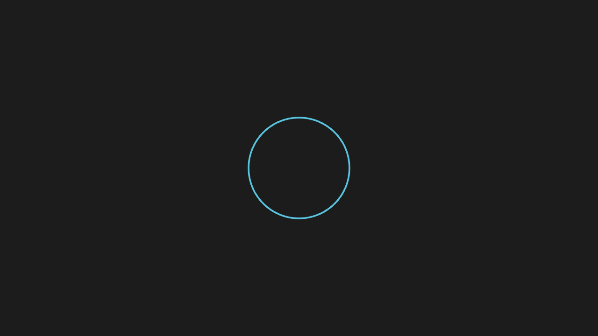
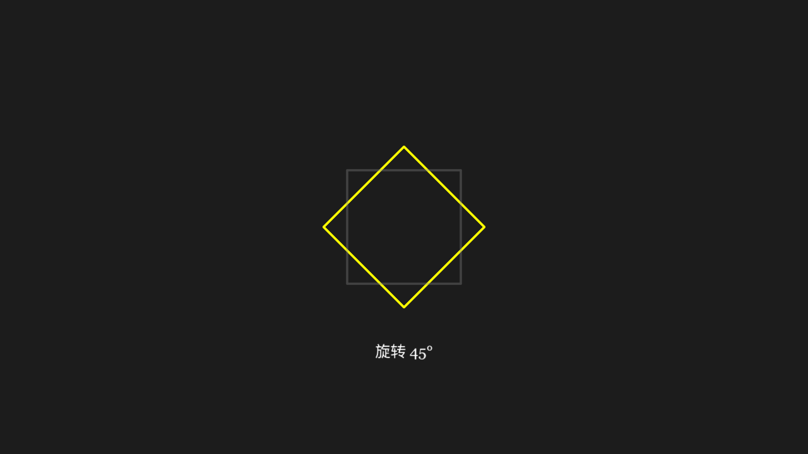
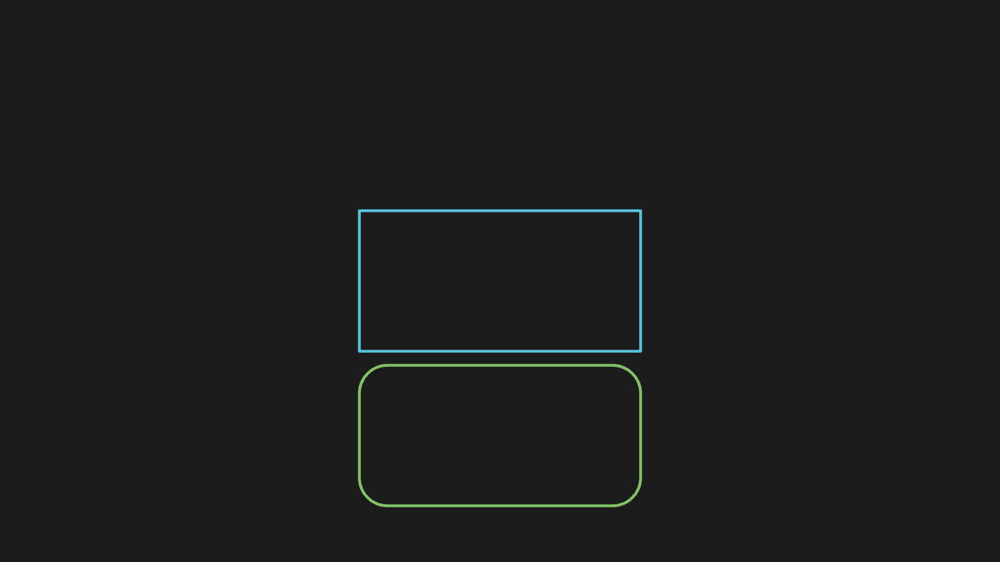
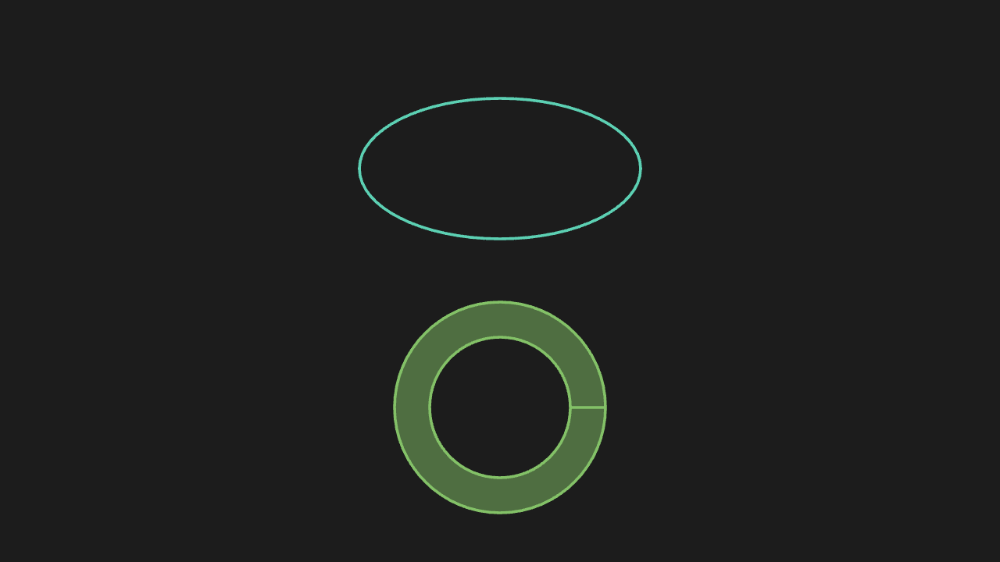
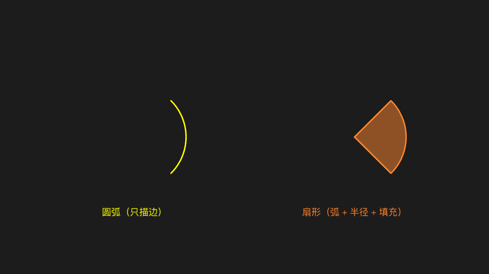
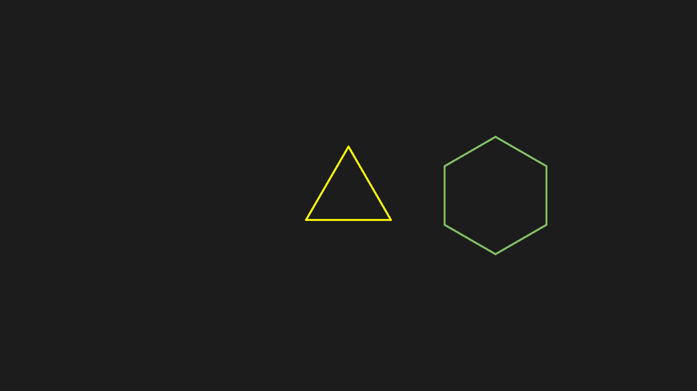
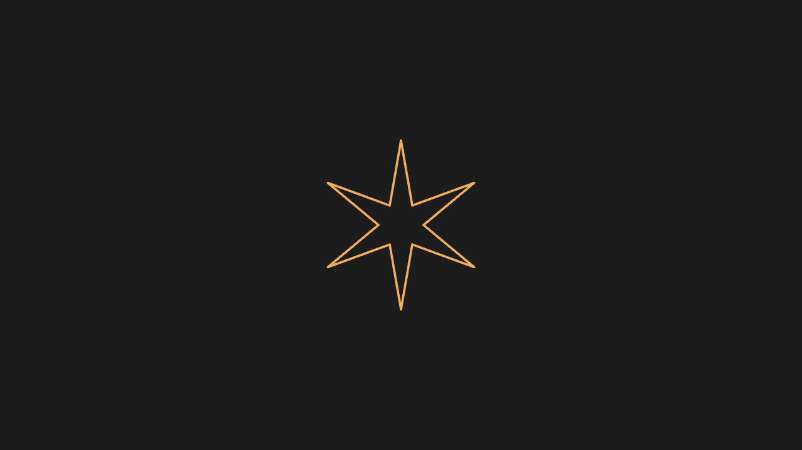
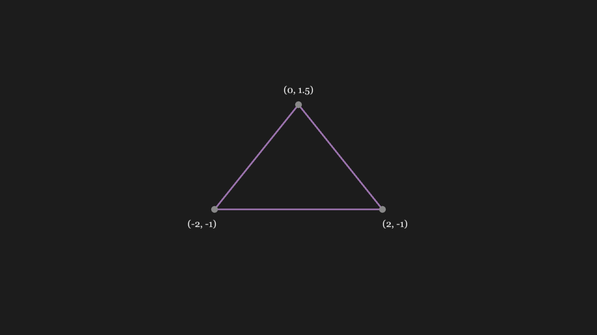
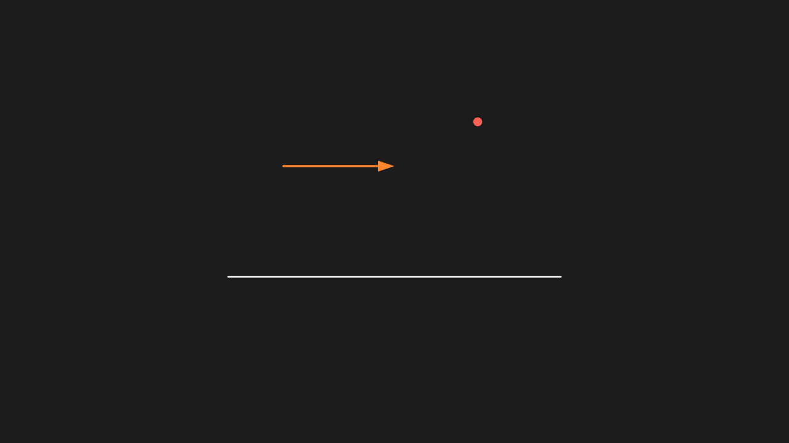
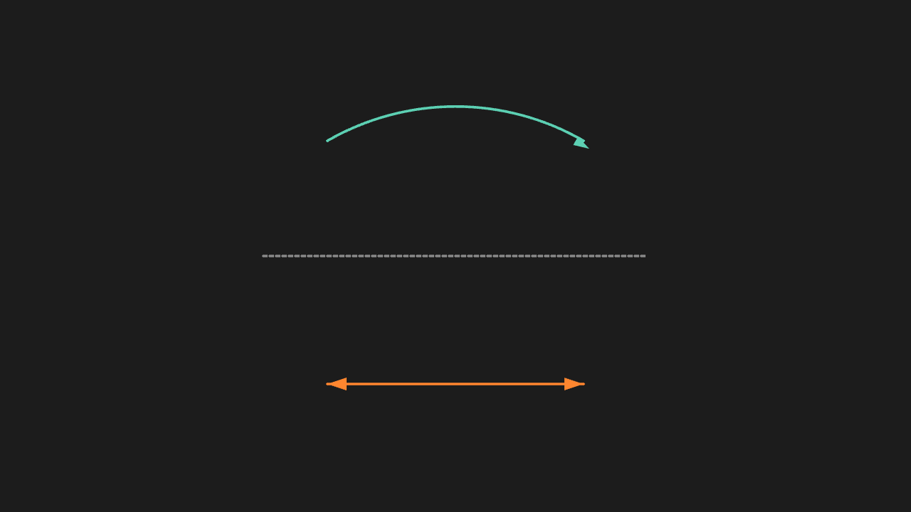

<!-- 本文件由 scripts/gen-examples-docs.mjs 生成，不要手改：改语料或翻译表后重跑脚本。 -->

# Basic shapes

The basic shapes — circle, rectangle, ellipse, arc, polygons, star — plus the line, dot and arrow variants.

This page lists 11 examples. The code is imported from `corpus/examples/basic/`; the screenshots are end states rendered on real machines.

## Draw a circle

A circle in the default stroke colour appears at the centre of the frame, drawn by Create tracing its outline.

::: code-group

<<< @/../corpus/examples/basic/01-circle.py[Code]

:::

## Rotate a square by 45°

The square rotates 45° about its own centre; position and size stay put.

::: code-group

<<< @/../corpus/examples/basic/02-square-rotate.py[Code]

:::

## Rectangle and rounded rectangle

A plain rectangle beside a rounded one; the smoothed corners are a visible difference.

::: code-group

<<< @/../corpus/examples/basic/03-rect-rounded.py[Code]

:::

## Ellipse and annulus

An ellipse and an annulus; the ring is hollow (an inner and an outer radius).

::: code-group

<<< @/../corpus/examples/basic/04-ellipse-annulus.py[Code]

:::

## Arc and sector

An arc (stroke only) and a sector (arc plus two radii plus fill).

::: code-group

<<< @/../corpus/examples/basic/05-arc-sector.py[Code]

:::

## Triangle and regular hexagon

A triangle and a regular hexagon side by side; the edge counts match the names.

::: code-group

<<< @/../corpus/examples/basic/06-polygons.py[Code]

:::

## Six-pointed star

A six-pointed star outline with six crisp tips.

::: code-group

<<< @/../corpus/examples/basic/07-star.py[Code]

:::

## Polygon from vertices

A polygon connecting the given vertices in order; the shape matches the coordinates.

::: code-group

<<< @/../corpus/examples/basic/08-polygon-vertices.py[Code]

:::

## Axes plus a function curve

A function curve on a set of axes; the curve follows the function and sits on the ticks.

::: code-group

<<< @/../corpus/examples/basic/09-axes-plot.py[Code]

:::

## Line, dot, arrow

One line, one dot and one arrow: the arrow carries a tip on one end and the dot sits where specified.

::: code-group

<<< @/../corpus/examples/basic/10-line-dot-arrow.py[Code]

:::

## Dashed, double arrow, arc arrow

The dashed line is broken, the double arrow has tips on both ends and the arc arrow curves — all three distinguishable at a glance.

::: code-group

<<< @/../corpus/examples/basic/11-line-variants.py[Code]

:::
