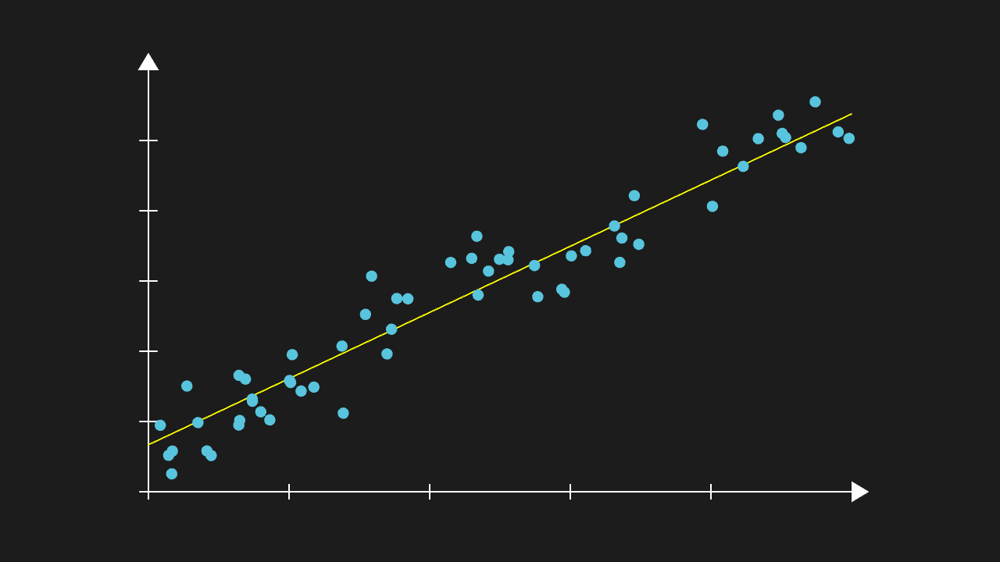
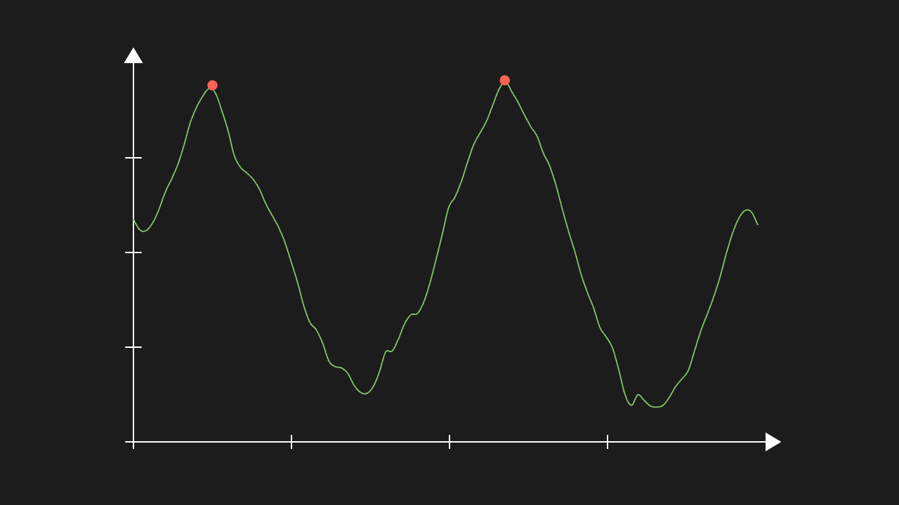
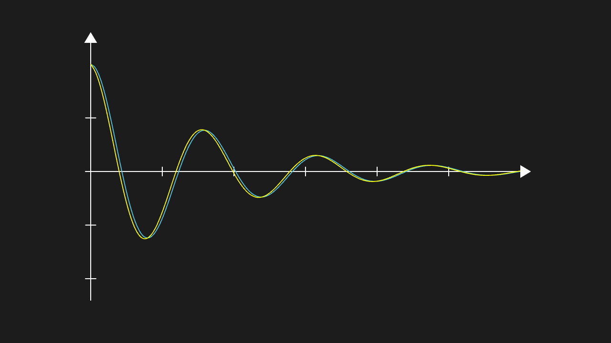
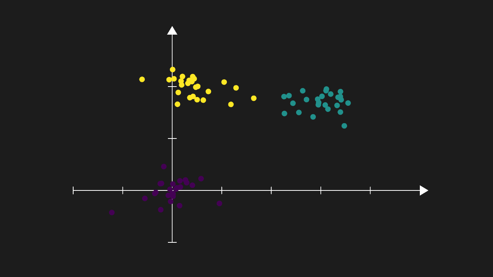

<!-- 本文件由 scripts/gen-examples-docs.mjs 生成，不要手改：改语料或翻译表后重跑脚本。 -->

# Combined pipelines (network)

pandas / scipy / sklearn / statsmodels / matplotlib chained into one Manim lesson pipeline; fetching the packages needs network access.

This page lists 5 examples. The code is imported from `corpus/examples/combo/`; the screenshots are end states rendered on real machines.

## Combined: pandas cleaning → sklearn fit → Manim drawing the line

Scattered data points plus a fitted line: the line follows the data trend with slope and intercept matching sklearn's result.

::: code-group

<<< @/../corpus/examples/combo/01-pandas-sklearn-fit.py[Code]

:::

## Combined: pandas rolling statistics + scipy.signal smoothing and peak finding

Raw data, smoothed curve and peak markers all present in three layers; peak positions match the data's features.

::: code-group

<<< @/../corpus/examples/combo/02-pandas-scipy-signal.py[Code]

:::

## Combined: scipy solving an ODE + numpy extracting the solution + Manim drawing two comparison curves

Two comparison curves whose shapes match the ODE's numerical solution, with legend and annotations complete.

::: code-group

<<< @/../corpus/examples/combo/03-scipy-numpy-ode.py[Code]

:::

## Combined: pandas building a table → statsmodels OLS fit and prediction → Manim drawing the regression

Table building, fitting and drawing in one pipeline: the fitted line follows the data and the prediction points land in sensible places.

::: code-group

<<< @/../corpus/examples/combo/04-pandas-statsmodels-ols.py[Code]

:::

## Combined: numpy making clusters → sklearn KMeans → matplotlib colours → Manim colouring

Scatter points coloured by KMeans cluster with colours taken from matplotlib: same cluster same colour, centres distinguishable.

::: code-group

<<< @/../corpus/examples/combo/05-sklearn-matplotlib-clusters.py[Code]

:::
