<!-- 本文件由 scripts/gen-examples-docs.mjs 生成，不要手改：改语料或翻译表后重跑脚本。 -->

# Constructor arguments

How positional and keyword arguments are taken: radius, side length, coordinates, vectors, control points, and VGroup's variadic arguments.

This page lists 14 examples. The code is imported from `corpus/examples/ctor/`; the screenshots are end states rendered on real machines.

## Circle positional argument (radius)

Two circles given only a radius differ in size; the radius values match the picture.

::: code-group

<<< @/../corpus/examples/ctor/01-circle-positional.py[Code]

:::

## Square positional argument (side length)

Two squares given only a side length differ in size.

::: code-group

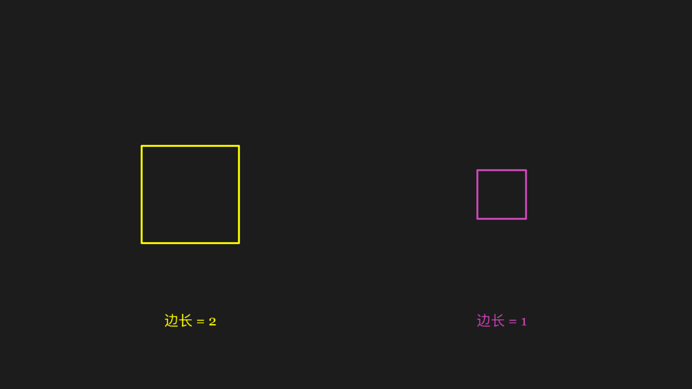

<<< @/../corpus/examples/ctor/02-square-positional.py[Code]

:::

## Dot positional argument (coordinates)

The dot lands at the given coordinates, not at the default origin.

::: code-group

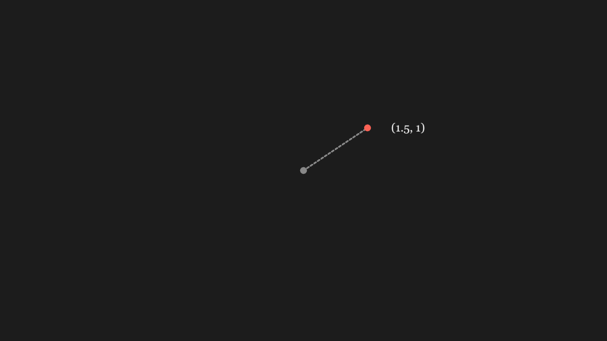

<<< @/../corpus/examples/ctor/03-dot-positional.py[Code]

:::

## Text weight, style and size

Several Text runs differ visibly in weight, italics and font size.

::: code-group

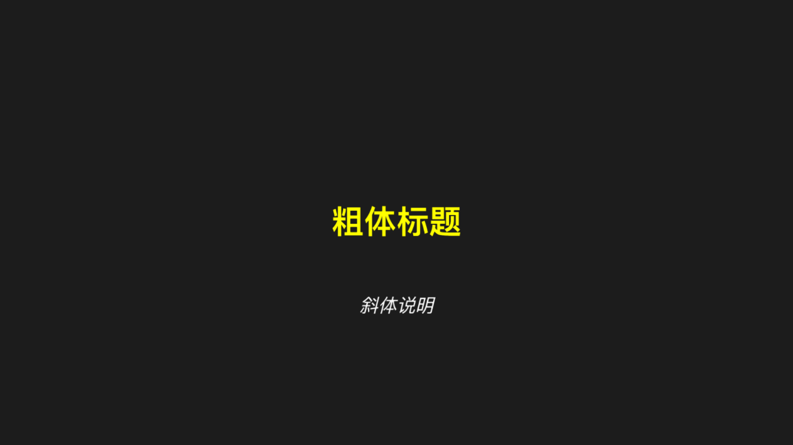

<<< @/../corpus/examples/ctor/04-text-kwargs.py[Code]

:::

## Vector positional argument

One arrow whose direction and length match the vector passed in.

::: code-group

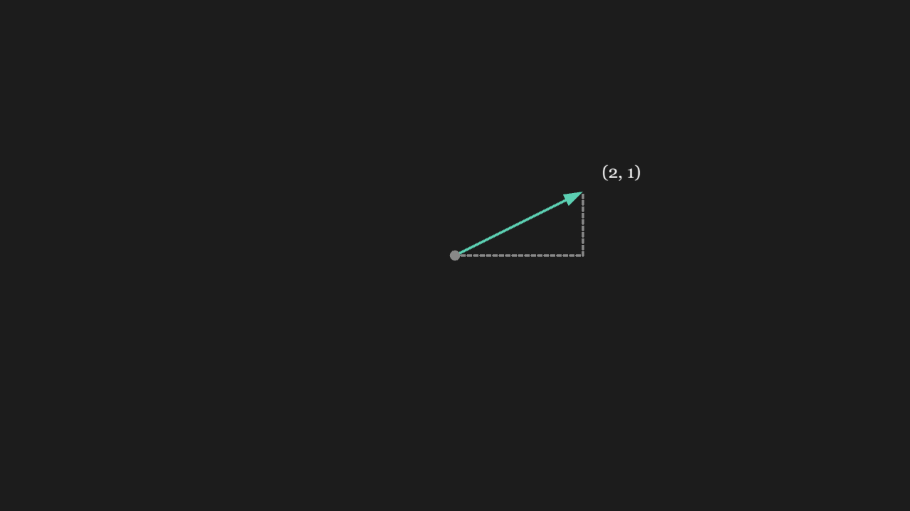

<<< @/../corpus/examples/ctor/05-vector.py[Code]

:::

## ParametricFunction positional argument

A curve drawn from the parametric equations; the shape matches them (neither a circle nor a line).

::: code-group

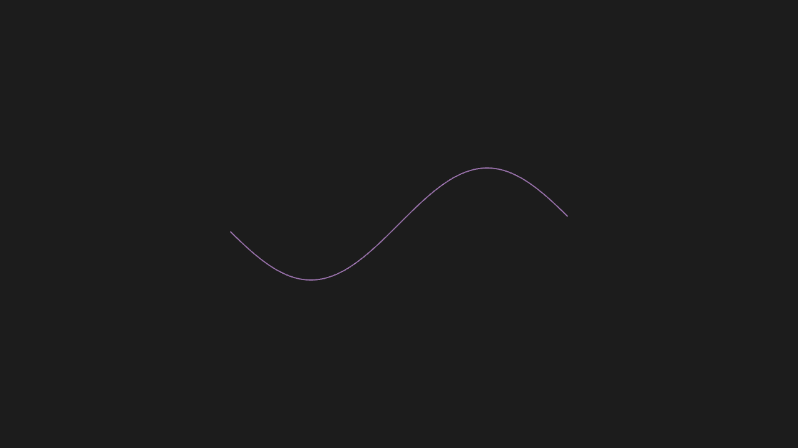

<<< @/../corpus/examples/ctor/06-parametric.py[Code]

:::

## FunctionGraph takes a function

The curve's shape matches the function passed in.

::: code-group

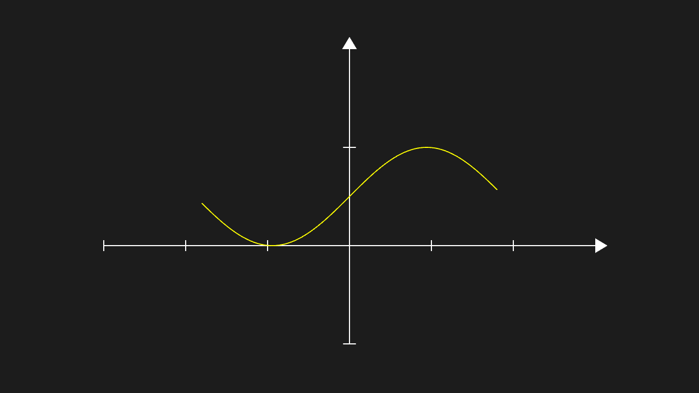

<<< @/../corpus/examples/ctor/07-function-graph.py[Code]

:::

## RightAngle takes two lines

A right-angle mark (a small elbow) stands at the intersection of the two lines.

::: code-group

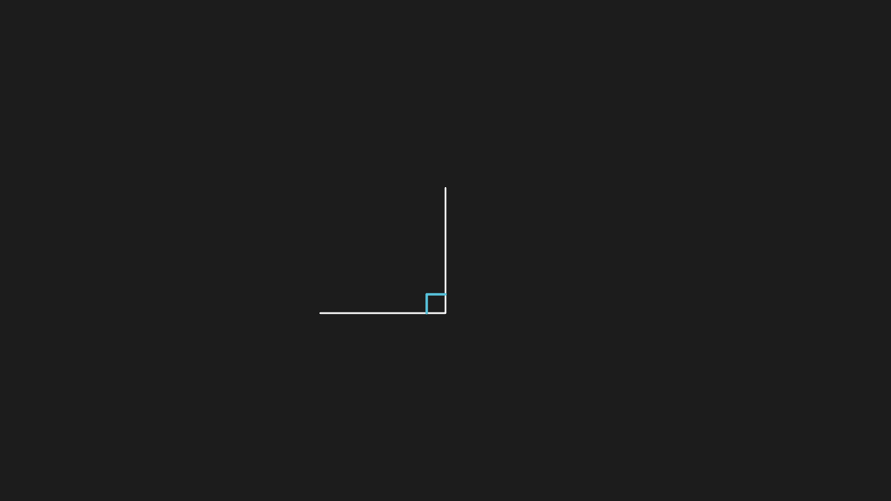

<<< @/../corpus/examples/ctor/08-right-angle.py[Code]

:::

## Angle takes three points

The arc opens across the angle determined by the three points; its opening matches the angle.

::: code-group

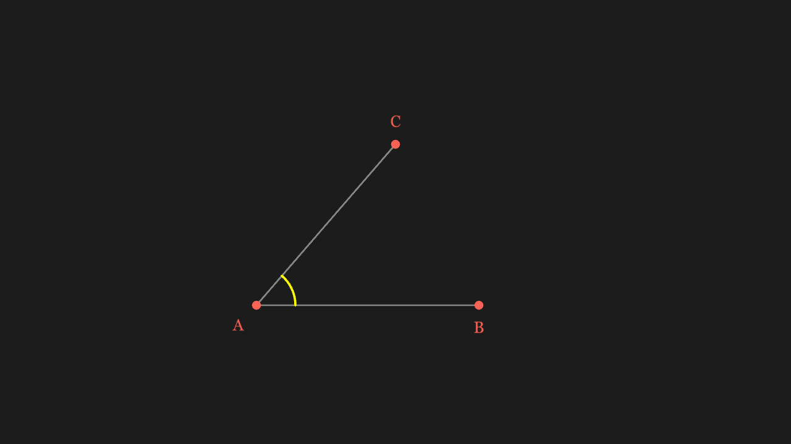

<<< @/../corpus/examples/ctor/09-angle-points.py[Code]

:::

## Brace takes one mobject

A brace hugs one side of the mobject, its length matching the mobject.

::: code-group

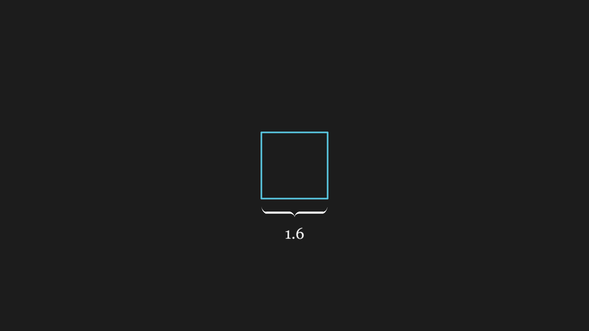

<<< @/../corpus/examples/ctor/10-brace.py[Code]

:::

## BraceBetweenPoints takes two points

A brace spans the two points, aligned with their connecting line and scaled to their distance.

::: code-group

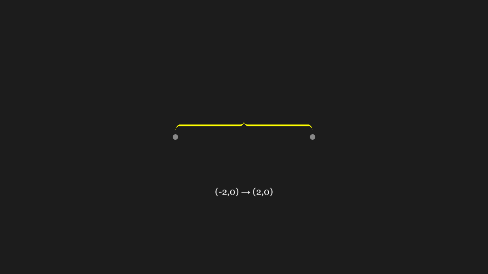

<<< @/../corpus/examples/ctor/11-brace-between.py[Code]

:::

## CubicBezier takes four points

The curve follows a cubic Bézier through the four control points, with its endpoints on the first and fourth.

::: code-group

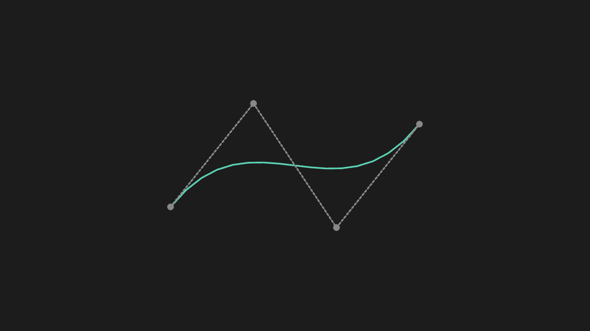

<<< @/../corpus/examples/ctor/12-cubic-bezier.py[Code]

:::

## ValueTracker takes an initial value

ValueTracker draws nothing (it is only a number); the scene renders without error and the other mobjects behave.

::: code-group

<<< @/../corpus/examples/ctor/13-value-tracker.py[Code]

:::

## VGroup variadic positional arguments

Several mobjects gathered into one VGroup move as a whole; their relative positions stay fixed.

::: code-group

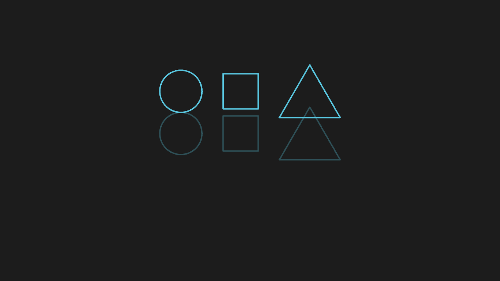

<<< @/../corpus/examples/ctor/14-vgroup-variadic.py[Code]

:::
