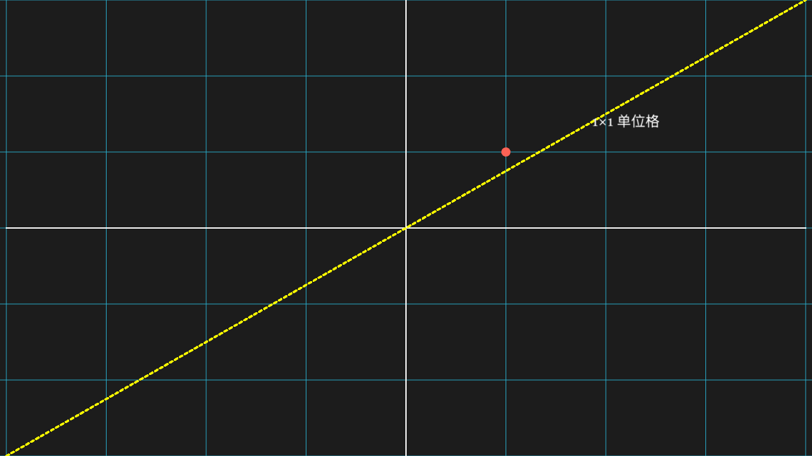
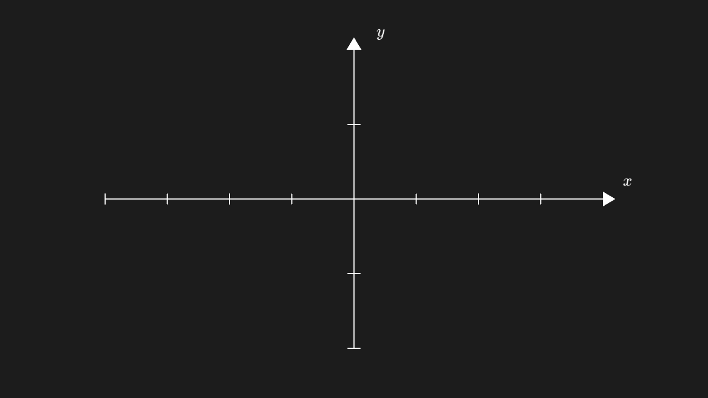
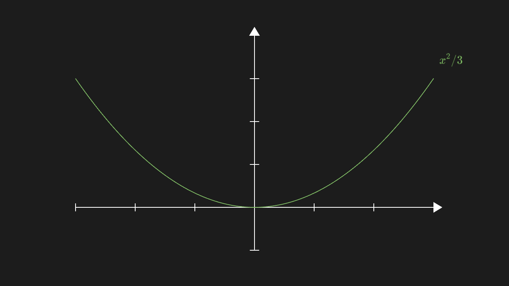
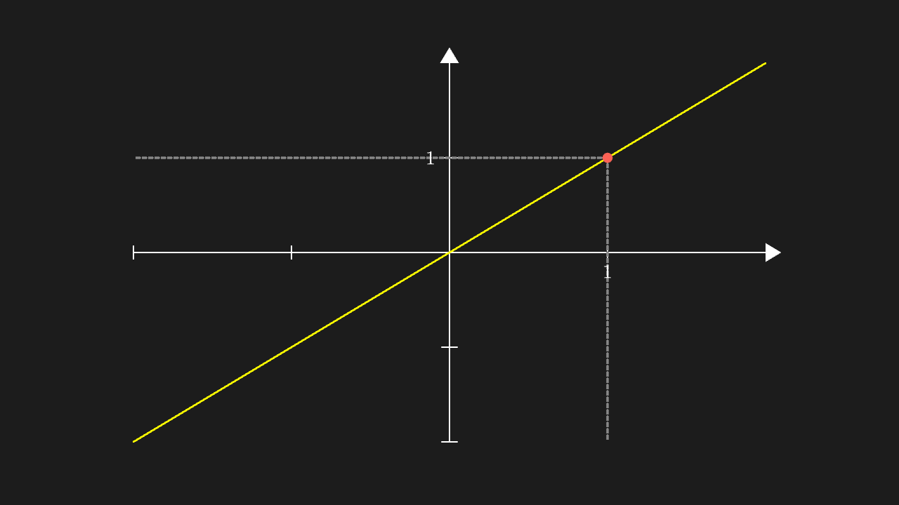
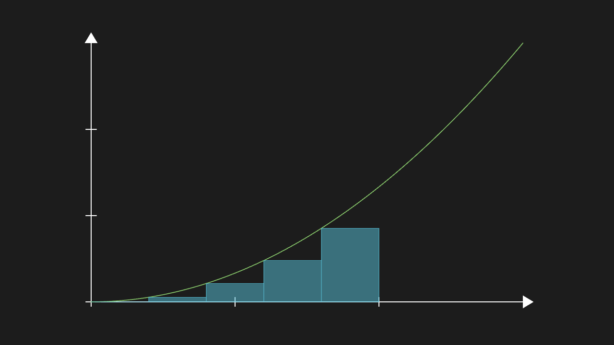
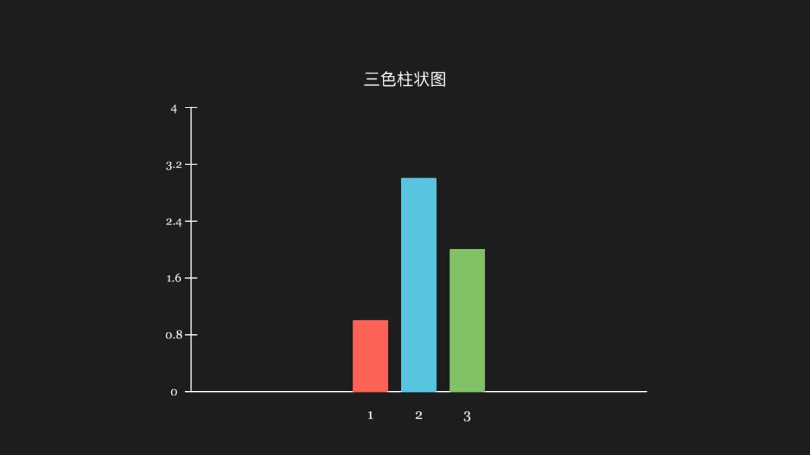
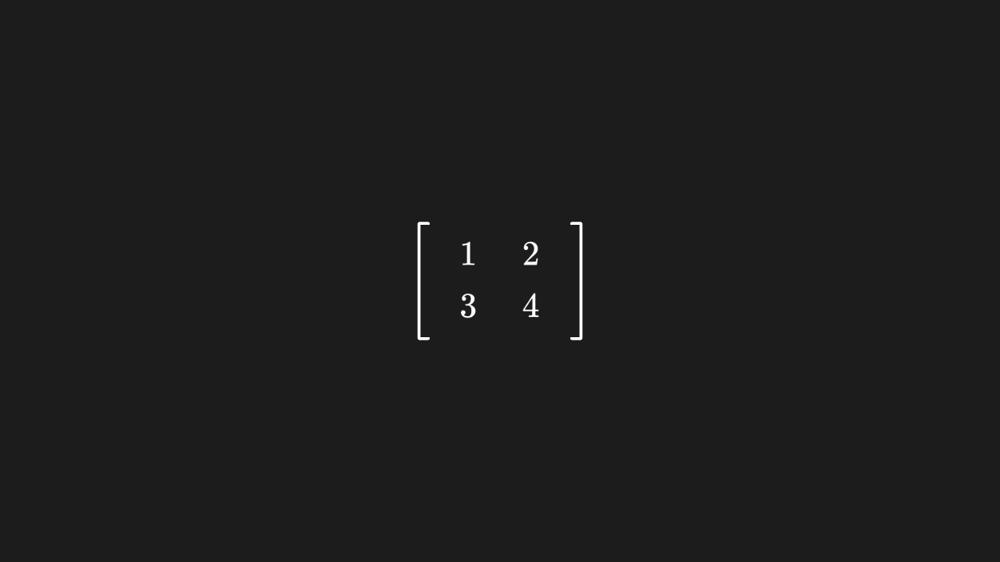
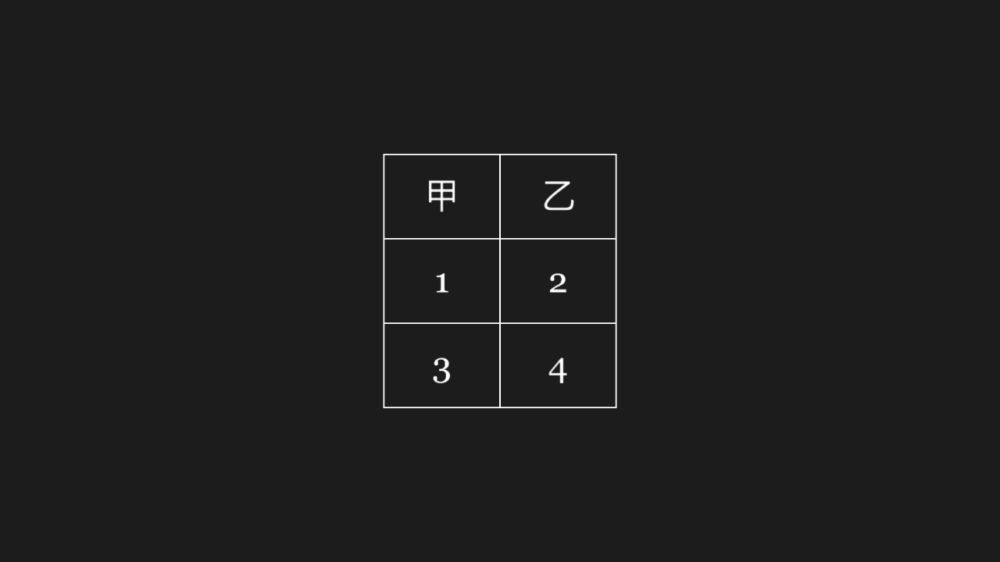
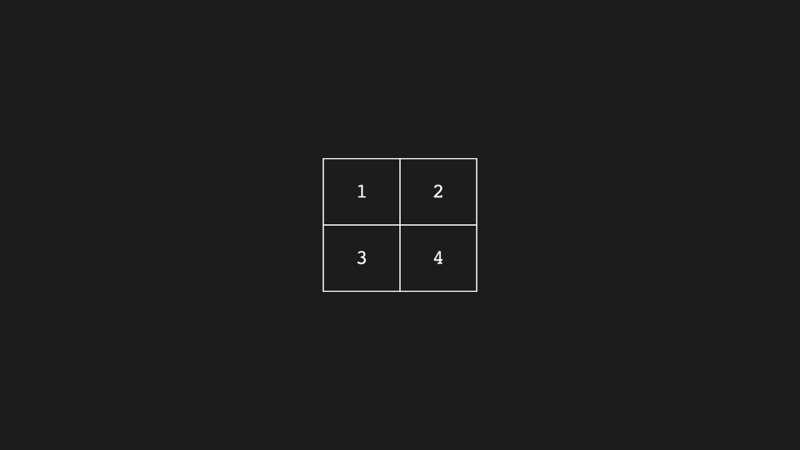
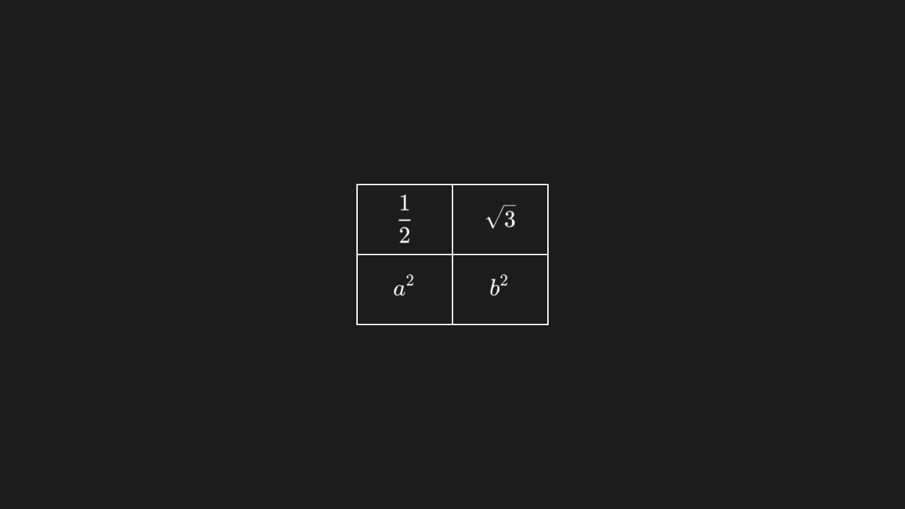

<!-- 本文件由 scripts/gen-examples-docs.mjs 生成，不要手改：改语料或翻译表后重跑脚本。 -->

# Axes and data

Number lines, grids, axis labels, c2p coordinate mapping, area and Riemann rectangles, plus bar charts, matrices and tables.

This page lists 12 examples. The code is imported from `corpus/examples/graph/`; the screenshots are end states rendered on real machines.

## Number line with numbers

One number line; ticks and tick numbers agree and the spacing is even.

::: code-group

<<< @/../corpus/examples/graph/01-number-line.py[Code]

:::

## Plane grid

A plane grid with both directions of lines complete and evenly spaced.

::: code-group

<<< @/../corpus/examples/graph/02-number-plane.py[Code]

:::

## Axes with axis labels

Axes with arrow tips and x / y labels; the labels sit at the axis ends.

::: code-group

<<< @/../corpus/examples/graph/03-axes-labels.py[Code]

:::

## Label on a curve

A label hugs its curve without leaving the frame or covering the line.

::: code-group

<<< @/../corpus/examples/graph/04-graph-label.py[Code]

:::

## c2p maps coordinates to canvas positions

The marker lands exactly at the position c2p computes; the printed numbers match the picture.

::: code-group

<<< @/../corpus/examples/graph/05-c2p.py[Code]

:::

## Area under a curve

A translucent fill between the curve and the x axis, bounded by the curve segment.

::: code-group

<<< @/../corpus/examples/graph/06-area.py[Code]

:::

## Riemann rectangles

A row of rectangles along the underside of the curve, heights following the sampled function values.

::: code-group

<<< @/../corpus/examples/graph/07-riemann.py[Code]

:::

## Bar chart

Three bars in red / blue / green with heights matching the data and even spacing; the title sits above without covering the chart.

::: code-group

<<< @/../corpus/examples/graph/08-bar-chart.py[Code]

:::

## Matrix

A matrix laid out by rows and columns; the entries match the input.

::: code-group

<<< @/../corpus/examples/graph/09-matrix.py[Code]

:::

## Table with a header

A table with a header row; rows and columns aligned and all grid lines present.

::: code-group

<<< @/../corpus/examples/graph/10-table.py[Code]

:::

## IntegerTable (numbers written directly)

Integers fill the cells directly (no LaTeX number formatting); the contents match.

::: code-group

<<< @/../corpus/examples/graph/11-integer-table.py[Code]

:::

## LaTeX table

The table content is typeset as LaTeX (math fonts), not plain text fonts.

::: code-group

<<< @/../corpus/examples/graph/12-math-table.py[Code]

:::
