# Gallery

Every screenshot below comes from this repository's corpus (`corpus/examples/`, 239 entries / 19 groups), rendered entry by entry in **a real Chromium** by `scripts/shot-corpus.mjs` — not mockups; each image corresponds to a piece of executable Python.

Sections follow domains and APIs, from basic shapes through linear algebra, analysis, probability, discrete math, and group theory, to third-party library combos. The animation process requires the local playground: after `pnpm playground`, entries can be played one by one.

::: info Why these are end-state screenshots
A screenshot captures the frame after an animation finishes playing. The **process** (how objects move and morph) cannot be shown statically; a few animation-focused entries end in a simple frame (for example, the object has already moved out of frame). For these, playback in the playground is authoritative.
:::

## Basic shapes and functions

<figure>
  
  <figcaption>Axes + function curve —— <code>basic/09-axes-plot.py</code></figcaption>
</figure>

<figure>
  
  <figcaption>Bar chart (red / blue / green; heights match the data) —— <code>graph/08-bar-chart.py</code></figcaption>
</figure>

<figure>
  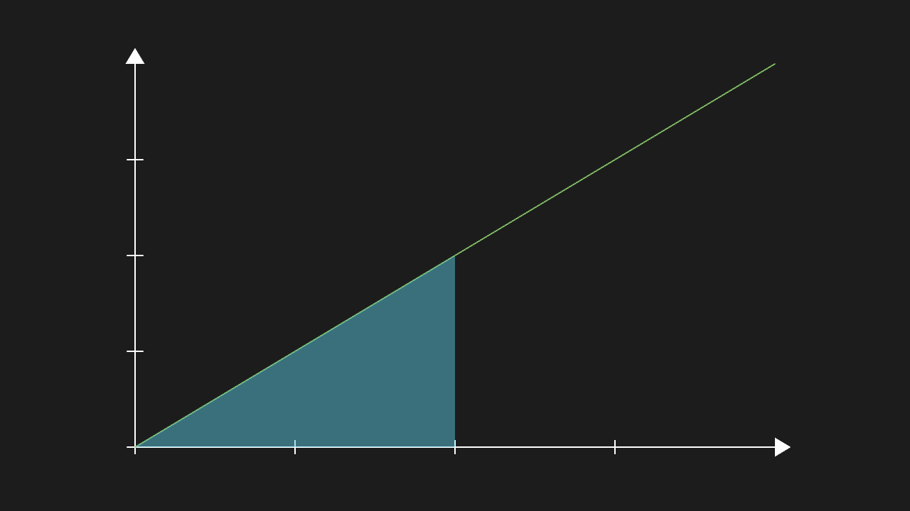
  <figcaption>Semi-transparent fill between the curve and the x-axis, bounded by the curve —— <code>graph/06-area.py</code></figcaption>
</figure>

## Text and formulas

<figure>
  
  <figcaption>MathTex: fractions get their bar, radicals cover the radicand —— <code>text/02-mathtex-frac.py</code></figcaption>
</figure>

<figure>
  
  <figcaption>MarkupText: local bold / color changes take effect, the rest is untouched —— <code>text/04-markup.py</code></figcaption>
</figure>

## Animations and updaters

<figure>
  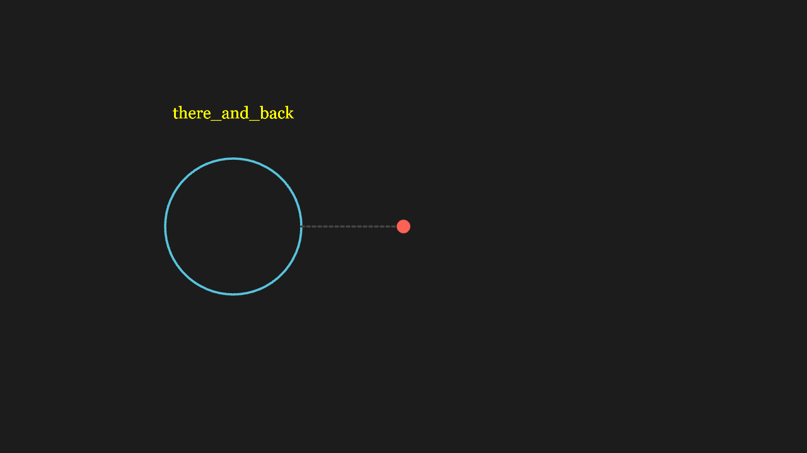
  <figcaption>Rate functions: the object reaches the target then returns along the same path (the signature of there_and_back) —— <code>animate/04-rate-variants.py</code></figcaption>
</figure>

<figure>
  
  <figcaption>TracedPath: a trail is drawn behind the moving dot, matching the path traveled —— <code>updater/01-traced-path.py</code></figcaption>
</figure>

## Linear algebra

<figure>
  
  <figcaption>Determinant: the unit square's area scales by |det| —— <code>math-linear/02-determinant-area.py</code></figcaption>
</figure>

<figure>
  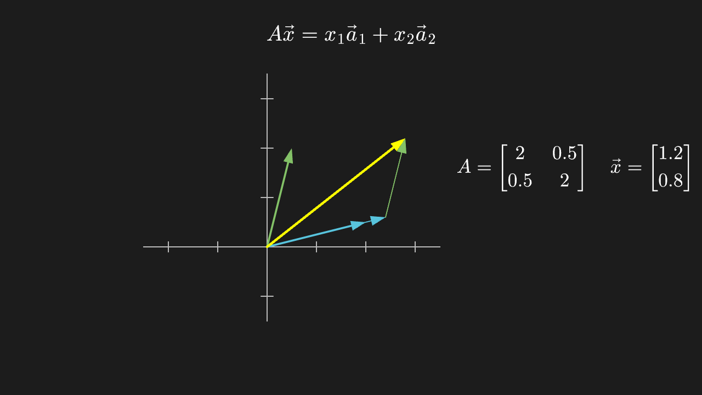
  <figcaption>Matrix × vector = linear combination of columns: two column vectors scale and form a parallelogram; its diagonal is A·x —— <code>math-linear/01-matrix-vector-product.py</code></figcaption>
</figure>

<figure>
  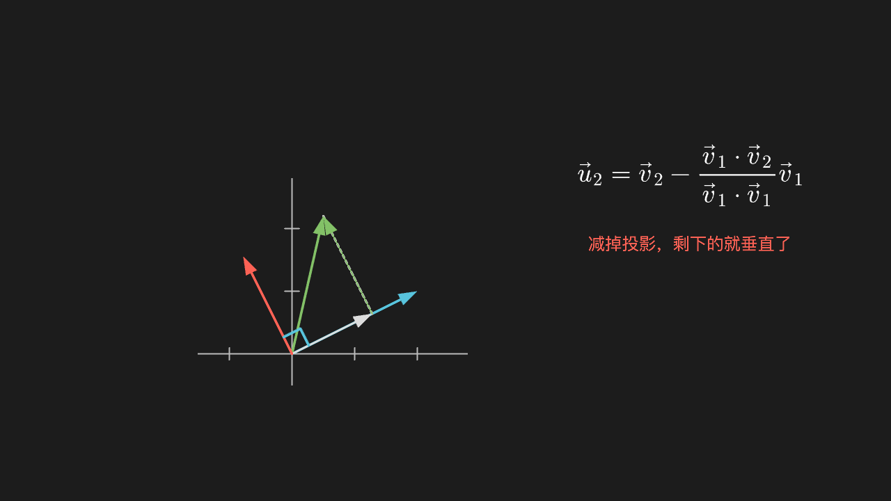
  <figcaption>Gram–Schmidt: the second vector minus its projection onto the first ends up perpendicular to it —— <code>math-linear/05-gram-schmidt.py</code></figcaption>
</figure>

<figure>
  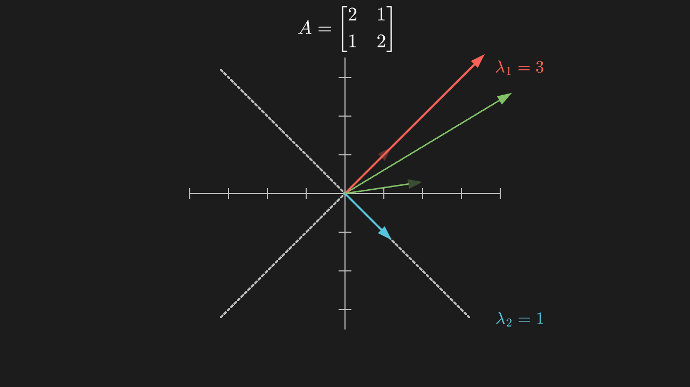
  <figcaption>Eigendecomposition: along the dashed directions, vectors keep their direction (only stretched); the third vector visibly rotates —— <code>math-linear/06-eigen-decomposition.py</code></figcaption>
</figure>

## Mathematical analysis

<figure>
  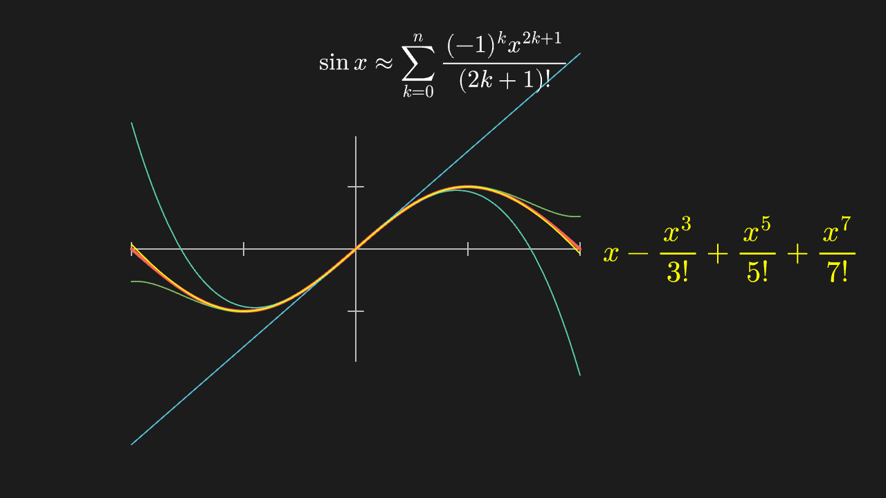
  <figcaption>Taylor expansion: degree 1 / 3 / 5 / 7 polynomials approach sin x, fitting near the origin first —— <code>math-calculus/03-taylor-sin.py</code></figcaption>
</figure>

<figure>
  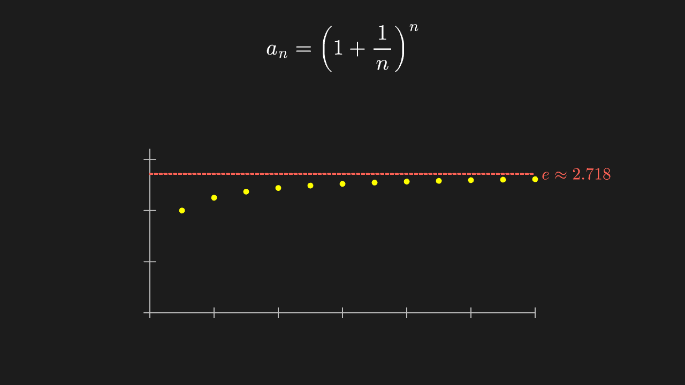
  <figcaption>Definition of e: the (1+1/n)ⁿ points rise monotonically, always below the y=e dashed line —— <code>math-calculus/04-e-definition.py</code></figcaption>
</figure>

<figure>
  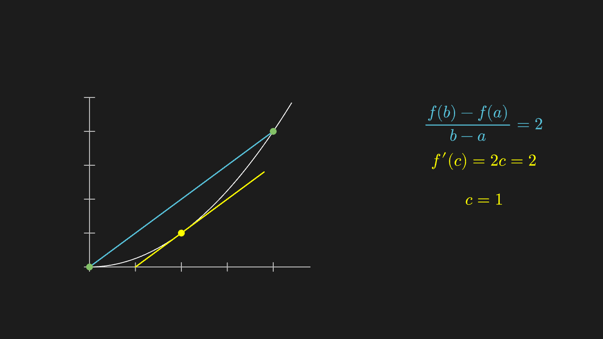
  <figcaption>Mean value theorem: the secant (blue) is parallel to the tangent at the midpoint (yellow) —— <code>math-calculus/05-mean-value-theorem.py</code></figcaption>
</figure>

<figure>
  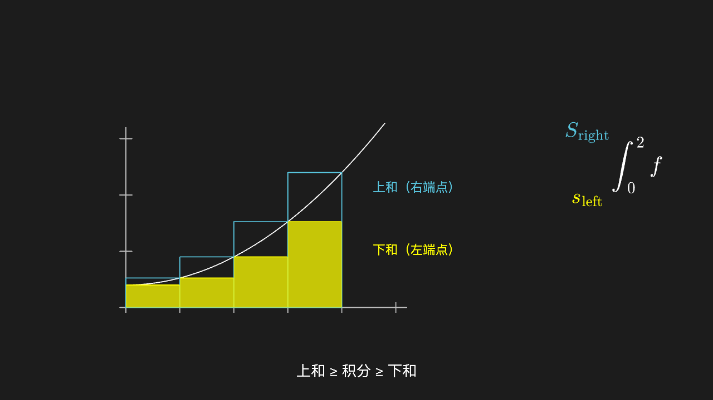
  <figcaption>Darboux sums: on the same partition, left-endpoint (low) and right-endpoint (high) rectangles sandwich the true value —— <code>math-calculus/06-upper-lower-sum.py</code></figcaption>
</figure>

## Probability and statistics

<figure>
  
  <figcaption>Monte Carlo estimate of π: 1200 points yield 3.140 —— <code>math-prob/10-monte-carlo-pi.py</code></figcaption>
</figure>

<figure>
  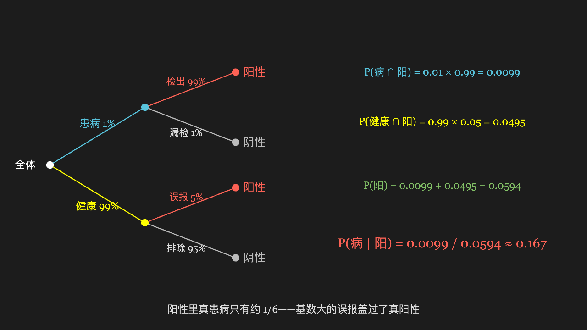
  <figcaption>Bayes' formula: a two-level tree lays out "diseased 1% × detected 99%" vs "healthy 99% × false alarm 5%" and combines them into the posterior —— <code>math-prob/03-bayes-tree.py</code></figcaption>
</figure>

<figure>
  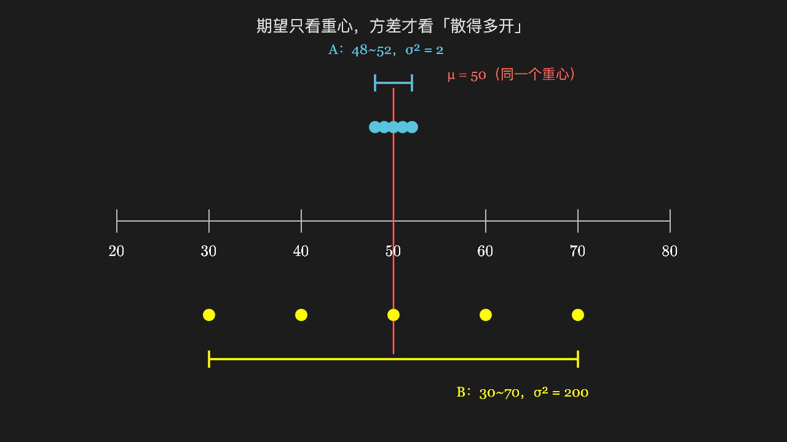
  <figcaption>Variance: two datasets share a mean and axis; one bunches up, one spreads wide, with lines marking each spread —— <code>math-prob/05-variance-spread.py</code></figcaption>
</figure>

<figure>
  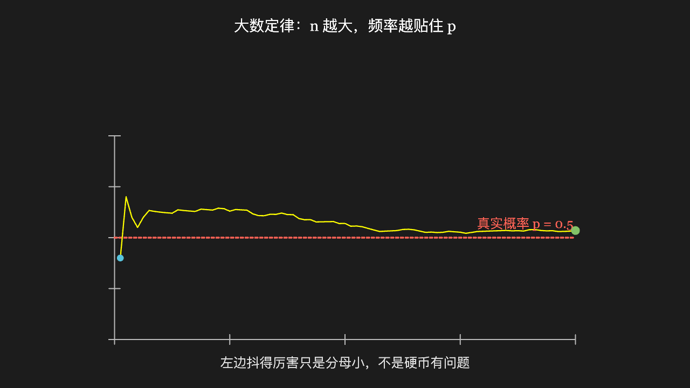
  <figcaption>Law of large numbers: the frequency line oscillates wildly at first, then settles onto the y=0.5 theoretical dashed line —— <code>math-prob/06-law-of-large-numbers.py</code></figcaption>
</figure>

## Discrete mathematics

<figure>
  
  <figcaption>Power-set lattice: 8 subsets arranged by inclusion as a cube projection —— <code>math-discrete/02-power-set-lattice.py</code></figcaption>
</figure>

<figure>
  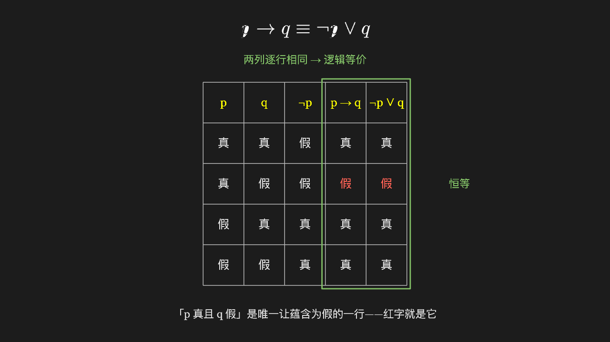
  <figcaption>Truth table: p→q vs ¬p∨q row by row; the last two columns share a green box — an identity —— <code>math-discrete/01-truth-table.py</code></figcaption>
</figure>

<figure>
  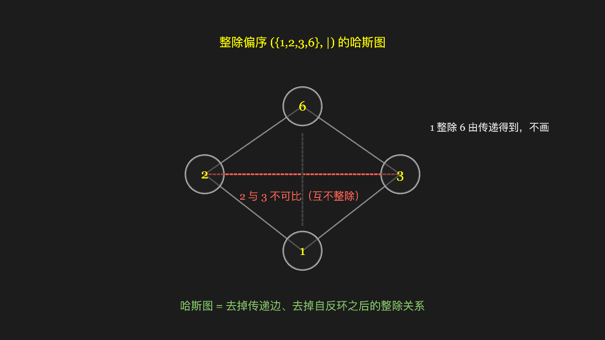
  <figcaption>Hasse diagram: {1,2,3,6} by divisibility forms a diamond; 2 and 3 sit side by side, incomparable, with no line —— <code>math-discrete/05-hasse-diagram.py</code></figcaption>
</figure>

## Group theory

<figure>
  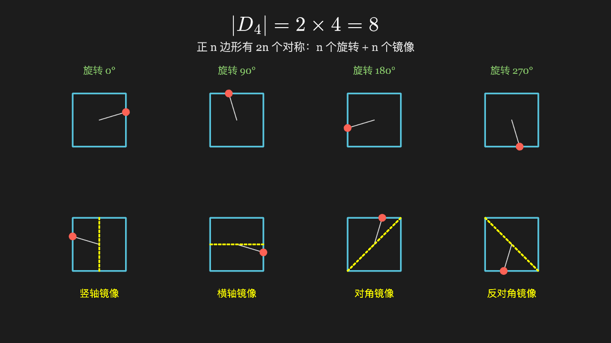
  <figcaption>Dihedral group D₄: the 8 symmetries of a square — 4 rotations on top, 4 mirrors below —— <code>math-group/03-dihedral-symmetry.py</code></figcaption>
</figure>

<figure>
  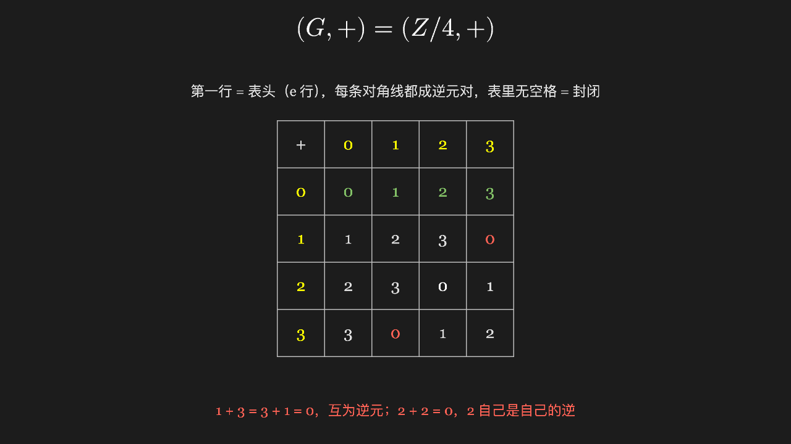
  <figcaption>Cayley table: the 4×4 (Z/4, +) table; the identity row matches the header, the axioms read straight off —— <code>math-group/02-cayley-table.py</code></figcaption>
</figure>

<figure>
  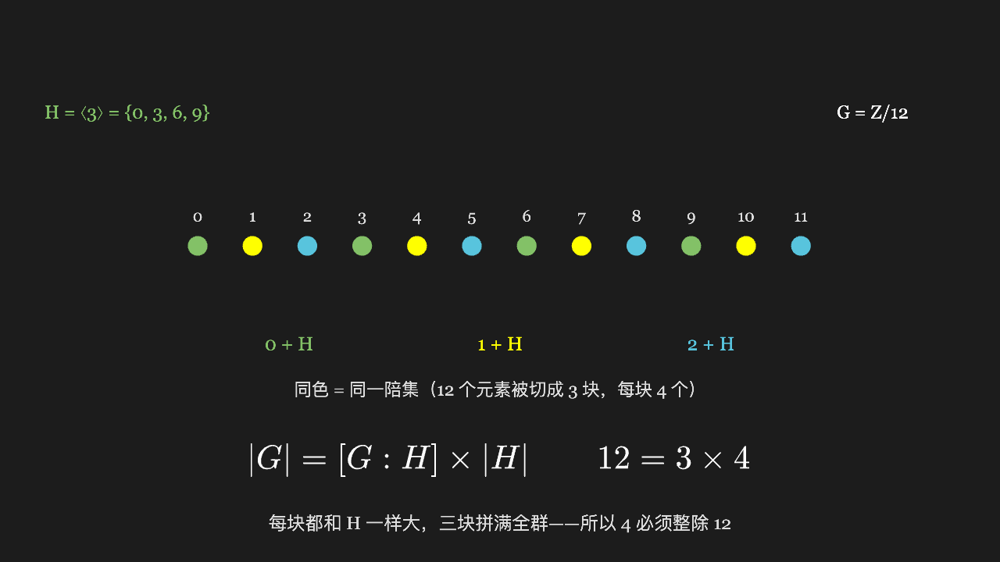
  <figcaption>Lagrange's theorem: 12 elements colored by coset — number of blocks × block size = group size —— <code>math-group/06-lagrange-theorem.py</code></figcaption>
</figure>

## 3D and composed lessons

<figure>
  
  <figcaption>A point rotates on the unit circle; the sin / cos lines stretch with the angle —— <code>lesson/01-unit-circle.py</code></figcaption>
</figure>

<figure>
  
  <figcaption>Polar rose: odd k gives k petals, even k gives 2k —— <code>lesson/04-polar-rose.py</code></figcaption>
</figure>

<figure>
  
  <figcaption>Real 3D: three faces visible at once with distinct shading (ThreeDScene) —— <code>lesson/13-space-cube-camera.py</code></figcaption>
</figure>

## Third-party library combos (pandas / scipy / sklearn / statsmodels)

<figure>
  
  <figcaption>pandas loads data + sklearn fits, and the result goes straight into the Manim scene —— <code>combo/01-pandas-sklearn-fit.py</code></figcaption>
</figure>

<figure>
  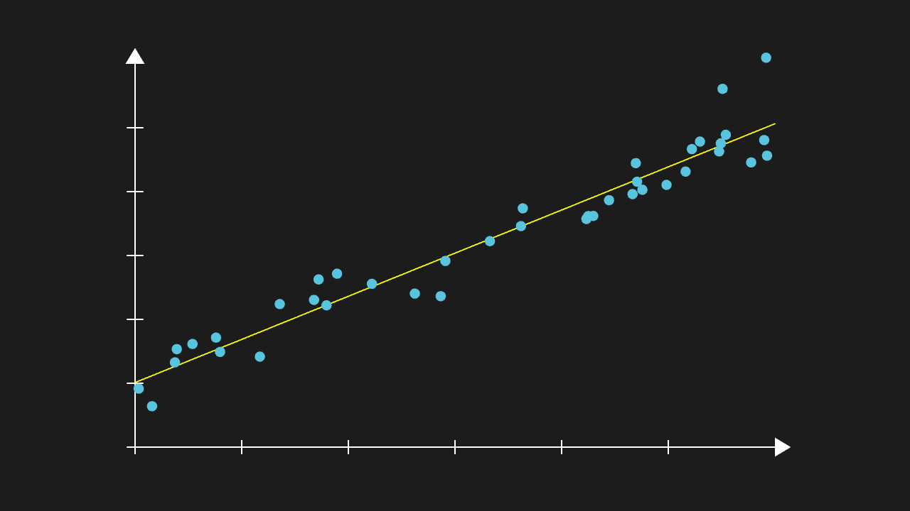
  <figcaption>statsmodels OLS regression: fitted line and sample points in one scene —— <code>combo/04-pandas-statsmodels-ols.py</code></figcaption>
</figure>

## Support surface (API coverage)

<figure>
  
  <figcaption>All 76 color constants rendered one by one (each distinct, not a black field) —— <code>api/01-colors.py</code></figcaption>
</figure>

This is a glimpse. The full list and screenshots of all **239 corpus entries in 19 groups** live in `corpus/shots/` (each image has a "what you should see" assertion in `index.json`); the item-by-item list of supported and unsupported APIs is in [Support Surface](/en/guide/support).

