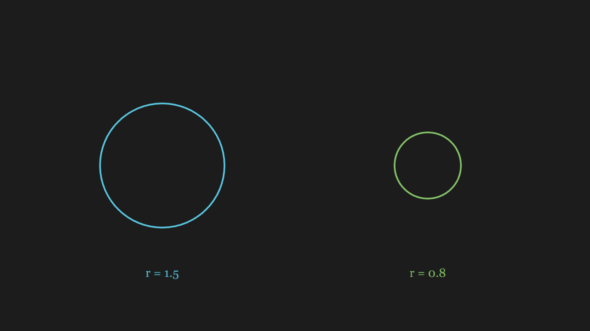
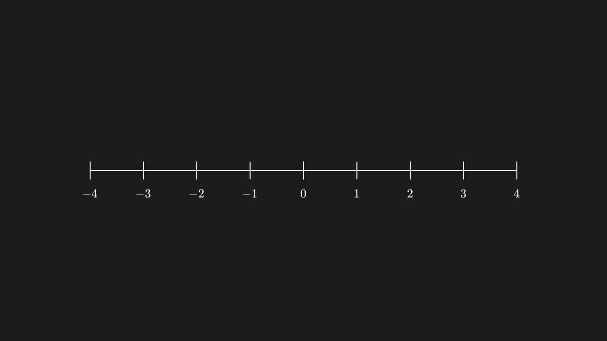
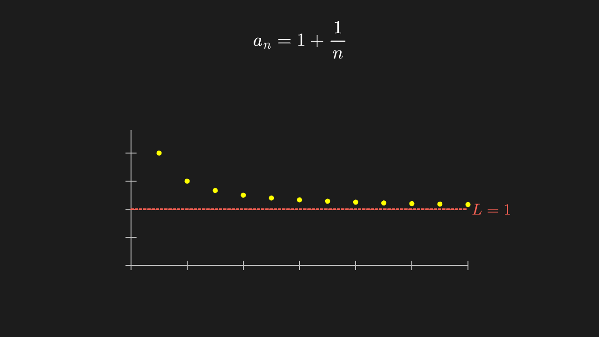
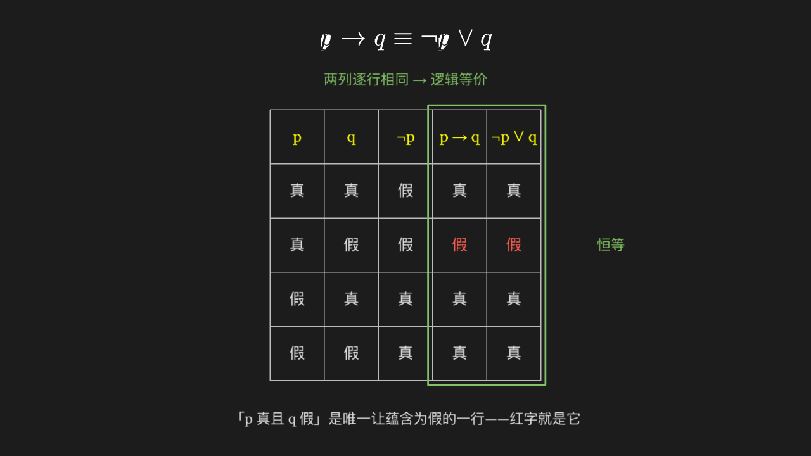

<!-- 本文件由 scripts/gen-examples-docs.mjs 生成，不要手改：改语料或翻译表后重跑脚本。 -->

# Gallery

Each page of this chapter corresponds to one corpus group. Every example offers two tabs: the default is Rendered — its end-state screenshot taken entry by entry in a real Chromium by `scripts/shot-corpus.mjs`; switching to Code shows the example's full source (imported straight from `corpus/examples/`, not copied).

The `net` group (packages fetched over the network) and the `reject` group (expected to be refused on the spot) have no screenshots and are not part of this chapter: the former regresses the fetch path, see [Third-Party Packages](/en/guide/packages); the latter regresses the refusal vocabulary, see [Support Surface](/en/guide/support).

  <a href="./basic"><figure><figcaption>Basic shapes · 11</figcaption></figure></a>
  <a href="./ctor"><figure><figcaption>Constructor arguments · 14</figcaption></figure></a>
  <a href="./method"><figure><figcaption>Methods and rewrites · 13</figcaption></figure></a>
  <a href="./graph"><figure><figcaption>Axes and data · 12</figcaption></figure></a>
  <a href="./text"><figure><figcaption>Text and formulas · 11</figcaption></figure></a>
  <a href="./syntax"><figure><figcaption>Syntax (offline) · 6</figcaption></figure></a>
  <a href="./animate"><figure><figcaption>Animations · 17</figcaption></figure></a>
  <a href="./updater"><figure><figcaption>Updaters and trails · 6</figcaption></figure></a>
  <a href="./scene"><figure><figcaption>Scenes and groups · 6</figcaption></figure></a>
  <a href="./math-calculus"><figure><figcaption>Calculus and analysis · 12</figcaption></figure></a>
  <a href="./math-linear"><figure><figcaption>Linear algebra · 12</figcaption></figure></a>
  <a href="./math-prob"><figure><figcaption>Probability and statistics · 12</figcaption></figure></a>
  <a href="./math-group"><figure><figcaption>Group theory · 12</figcaption></figure></a>
  <a href="./math-discrete"><figure><figcaption>Discrete mathematics · 12</figcaption></figure></a>
  <a href="./lesson"><figure><figcaption>Lesson scenes (templates) · 13</figcaption></figure></a>
  <a href="./api"><figure><figcaption>API roll call (offline) · 14</figcaption></figure></a>
  <a href="./combo"><figure><figcaption>Combined pipelines (network) · 5</figcaption></figure></a>

