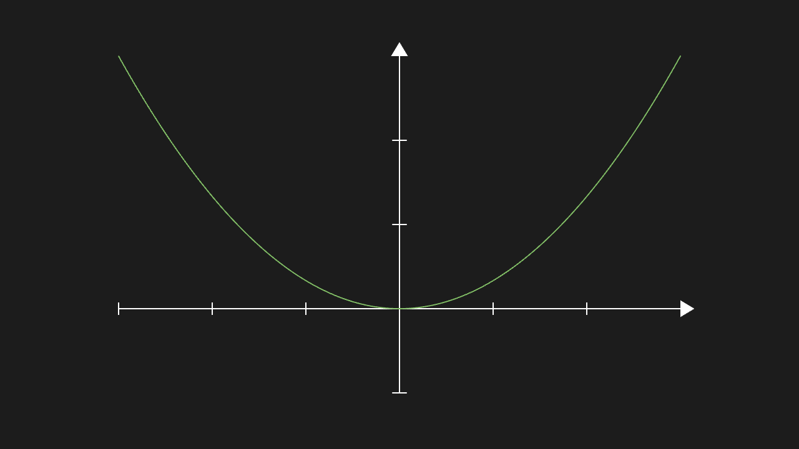
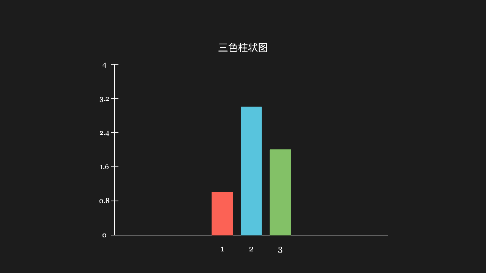
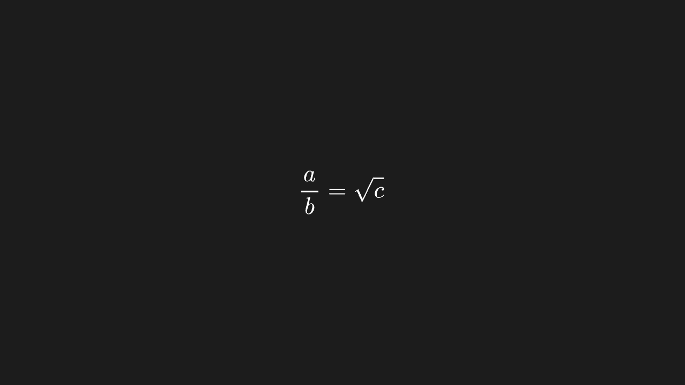
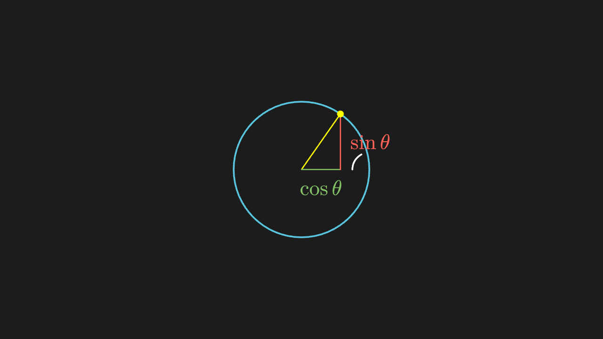
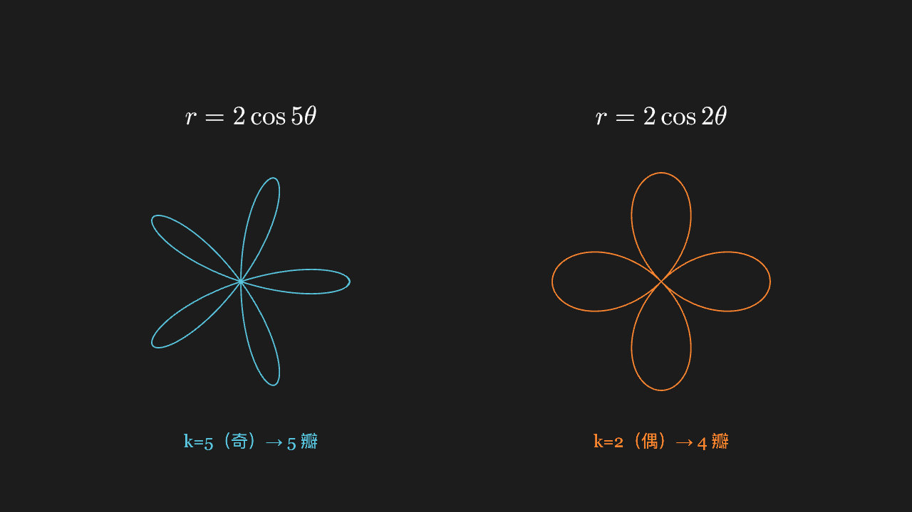
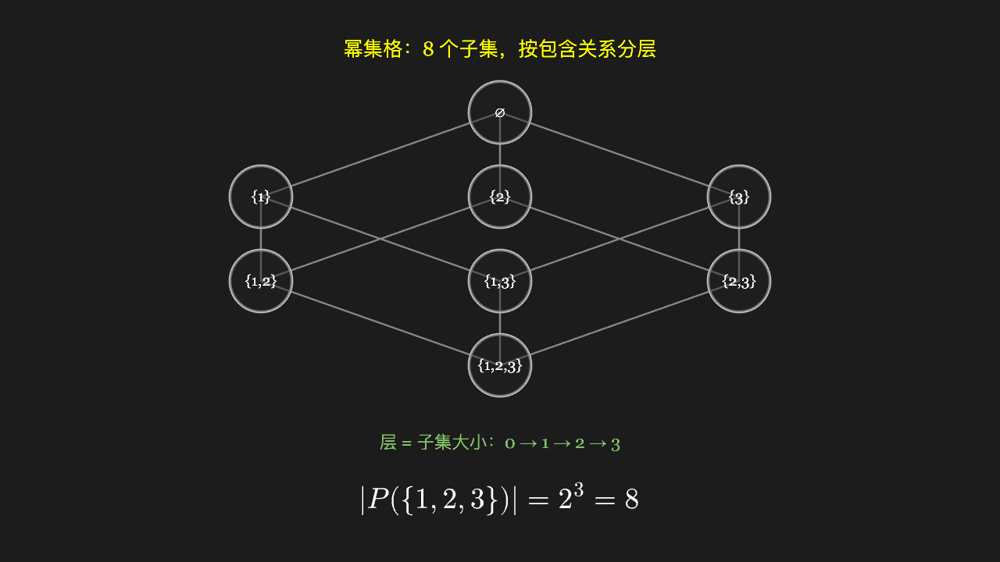
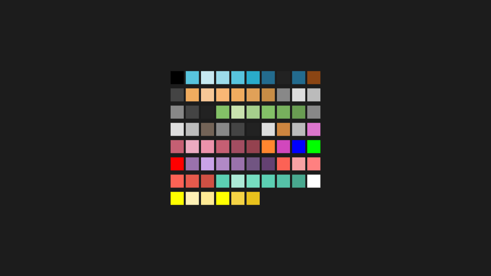

# Rendered Gallery

All screenshots below come from this repository's corpus (`_dev/examples/`, 239 entries),
rendered **entry by entry with a real Chromium** by `scripts/shot-corpus.mjs` — not design
mocks; behind every image is a piece of runnable Python. To watch the animations, run
`pnpm playground` to start the local playground and play each entry for real.

::: info Why final-state screenshots
A screenshot grabs the frame after the animation finishes. The animation **process** (how
objects move and morph) cannot be conveyed by a static image; and some heavily animated
entries have rather plain final states (e.g. "the object flew off-screen"). For those,
trust the live playback in the playground.
:::

## Basic Shapes and Functions

<figure>
  
  <figcaption>Axes + function curve — <code>basic/09-axes-plot.py</code></figcaption>
</figure>

<figure>
  
  <figcaption>Bar chart (red / blue / green, heights match the data) — <code>graph/08-bar-chart.py</code></figcaption>
</figure>

## Text and Formulas

<figure>
  
  <figcaption>MathTex: fractions with a bar, radicals covering the radicand (KaTeX typesetting) — <code>text/02-mathtex-frac.py</code></figcaption>
</figure>

## Math Classroom

<figure>
  
  <figcaption>A point rotates on the unit circle; the sin / cos lines stretch with the angle — <code>lesson/01-unit-circle.py</code></figcaption>
</figure>

<figure>
  
  <figcaption>Polar rose: odd k gives k petals, even k gives 2k — <code>lesson/04-polar-rose.py</code></figcaption>
</figure>

<figure>
  
  <figcaption>Real 3D: three faces visible at once, each shaded differently (ThreeDScene) — <code>lesson/13-space-cube-camera.py</code></figcaption>
</figure>

## Linear Algebra · Probability · Discrete

<figure>
  
  <figcaption>Determinant: the unit square's area is scaled by |det| — <code>math-linear/02-determinant-area.py</code></figcaption>
</figure>

<figure>
  
  <figcaption>Monte Carlo estimate of π: 1200 points yield 3.140 — <code>math-prob/10-monte-carlo-pi.py</code></figcaption>
</figure>

<figure>
  
  <figcaption>Power set lattice: 8 subsets arranged by inclusion as a cube projection — <code>math-discrete/02-power-set-lattice.py</code></figcaption>
</figure>

## Coverage (API Surface)

<figure>
  
  <figcaption>All 76 color constants, each colored in (all distinct, not a sea of black) — <code>api/01-colors.py</code></figcaption>
</figure>

This is just a glimpse. The complete inventory of **239 entries across 17 groups**, with
screenshots, lives in `_dev/shots/` (every image has a "what should be visible" assertion
in `index.json`); groups run from basic shapes, animations, updaters, and scene operations
all the way to calculus, linear algebra, probability, group theory, and discrete math.

## Appendix: Full Source of the First Entry Above

It is the same segment run in "Quick Start" — the verbatim `_dev/examples/basic/09-axes-plot.py`:

```python
from manim import *


class AxesPlotScene(Scene):
    def construct(self):
        ax = Axes(x_range=[-3, 3, 1], y_range=[-1, 3, 1])
        graph = ax.plot(lambda x: x * x / 3, color=GREEN)
        self.play(Create(ax), Create(graph))
        self.wait(0.3)
```

Ordinary Manim CE style, with no package-specific incantations. The adapter layer
translates it into manim-web calls; where CE syntax and this package's empirically
supported surface differ, `renderer.check()` names it during the precheck.

<style>
img { width: 100%; max-width: 720px; display: block; margin: 0 auto; border-radius: 8px; border: 1px solid var(--vp-c-divider); }
figure { margin: 8px 0 28px; }
figcaption { font-size: 13px; color: var(--vp-c-text-2); text-align: center; margin-top: 6px; }
</style>
