<!-- 本文件由 scripts/gen-examples-docs.mjs 生成，不要手改：改语料或翻译表后重跑脚本。 -->

# Lesson scenes (templates)

Reusable lesson patterns: unit circle, sine-wave tracing, Pythagoras, polar curves, secant-to-tangent, Riemann sums, linear maps and probability comparisons.

This page lists 13 examples. The code is imported from `corpus/examples/lesson/`; the screenshots are end states rendered on real machines.

## Unit circle and trigonometric lines

A point travels on the unit circle while the sine / cosine lines stretch with the angle; their lengths match the angle.

::: code-group

<<< @/../corpus/examples/lesson/01-unit-circle.py[Code]

:::

## Tracing a sine wave from a point on the circle

As the point on the circle turns, the wave unfolds to the right and what is drawn is exactly the sine curve (a full sine of amplitude ±1.2, observed in real time; with turbo screenshots the sparse frames can collapse a TracedPath trail into a straight line — a screenshot artefact).

::: code-group

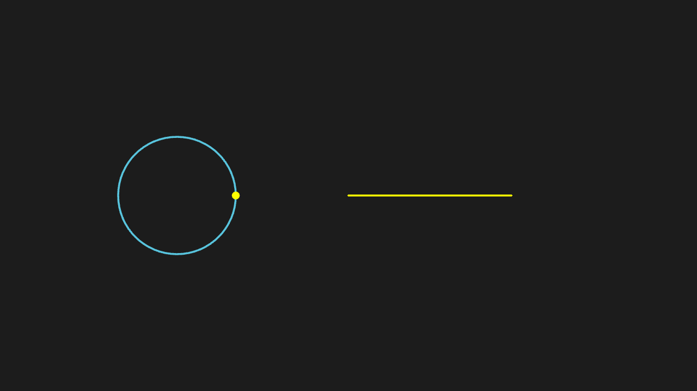

<<< @/../corpus/examples/lesson/02-sine-wave-trace.py[Code]

:::

## The Pythagorean theorem

Squares on the three sides of a right triangle present the area relation a² + b² = c².

::: code-group

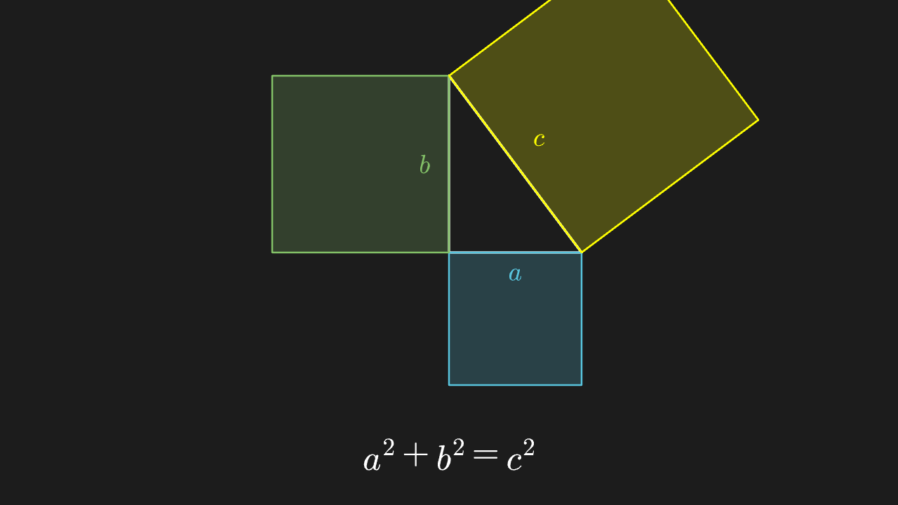

<<< @/../corpus/examples/lesson/03-pythagorean.py[Code]

:::

## Polar rose curve

The petal count matches the equation parameters: left k=5 gives 5 petals (k odd), right k=2 gives 4 petals (2k petals, k even); each curve carries its equation label so the odd-k → k petals / even-k → 2k petals rule is readable by comparison.

::: code-group

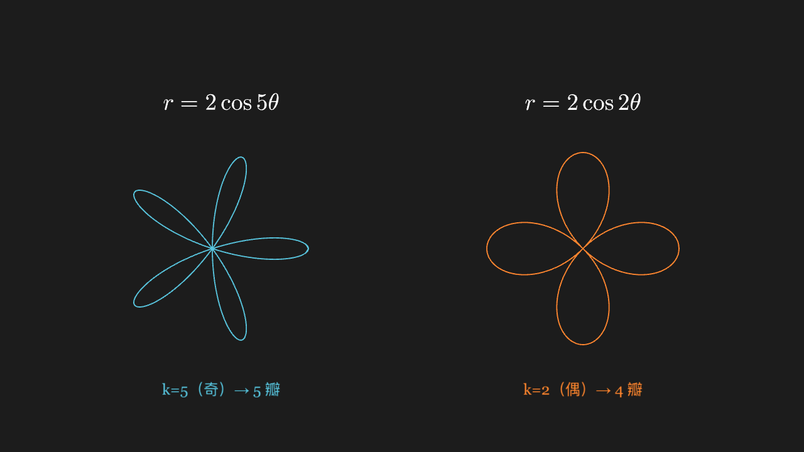

<<< @/../corpus/examples/lesson/04-polar-rose.py[Code]

:::

## Archimedean spiral

The spiral widens turn by turn with a constant gap between turns (the defining trait of an Archimedean spiral).

::: code-group

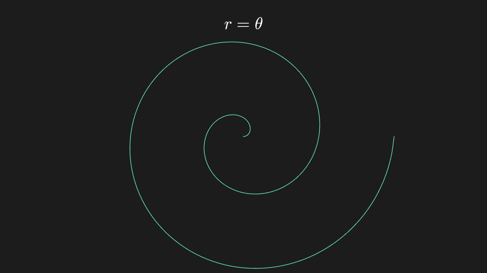

<<< @/../corpus/examples/lesson/05-polar-spiral.py[Code]

:::

## Secants approaching the tangent (the definition of the derivative)

The secant rotates about the tangency point, hugging the tangent ever closer until they coincide.

::: code-group

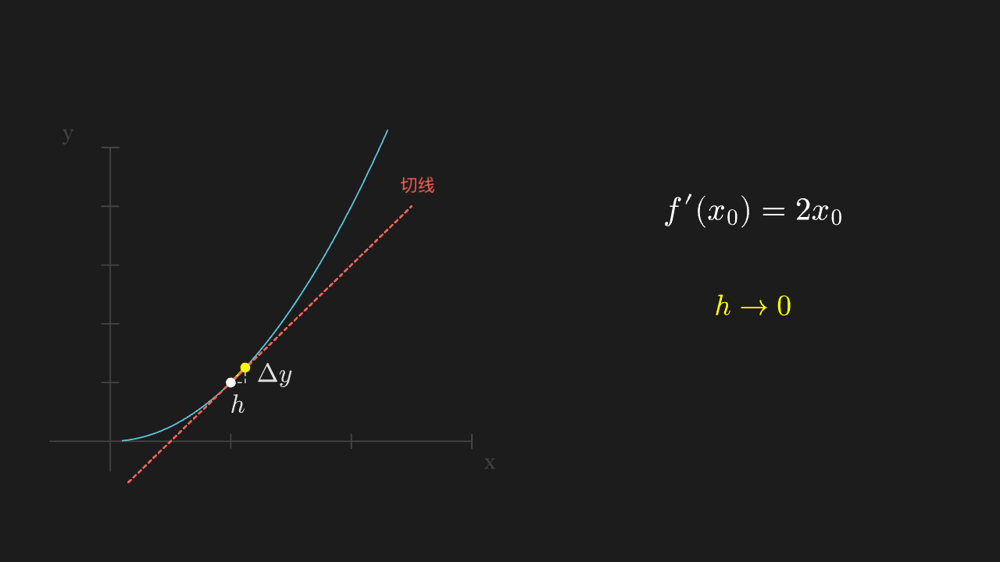

<<< @/../corpus/examples/lesson/06-secant-tangent.py[Code]

:::

## Riemann sums approaching the integral

The rectangles get finer and their area sum approaches the definite integral: the coarse dx=1 rectangles stay in the final frame as stroked ghosts next to the fine dx=0.25 ones, and the two labels on the right give both area sums (1.60 → 2.63, true value 2.27).

::: code-group

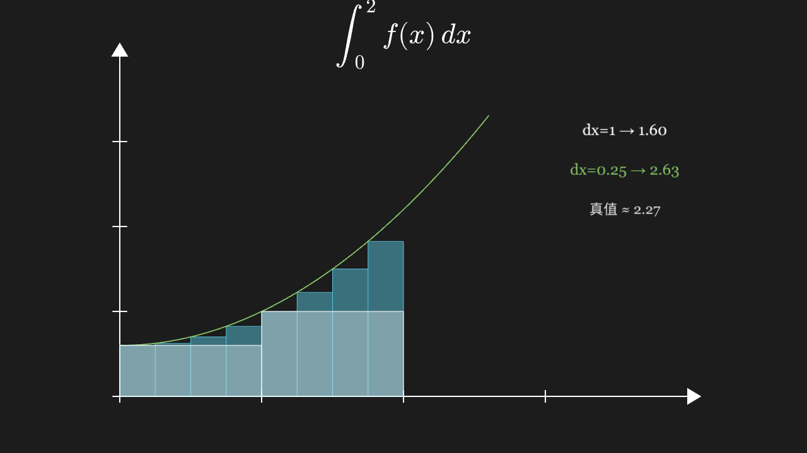

<<< @/../corpus/examples/lesson/07-riemann-sum.py[Code]

:::

## Linear map: rotation

Grid and vectors rotate 30° as a whole (not a multiple of 90°, so the tilted orientation is obvious) without changing shape; the matrix is written in cos/sin 30° form, the green arrow is 2 cells long and still aligns with the grid ticks after rotation.

::: code-group

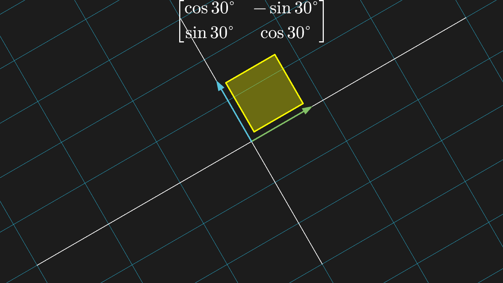

<<< @/../corpus/examples/lesson/08-linear-rotate.py[Code]

:::

## Linear map: shear

The grid is sheared: rows shift horizontally and columns tilt; the pre-image grid stays in place as a low-opacity ghost for comparison, and a 1×1 reference square becomes a parallelogram with the same base and height — area per cell unchanged (det=1), visibly.

::: code-group

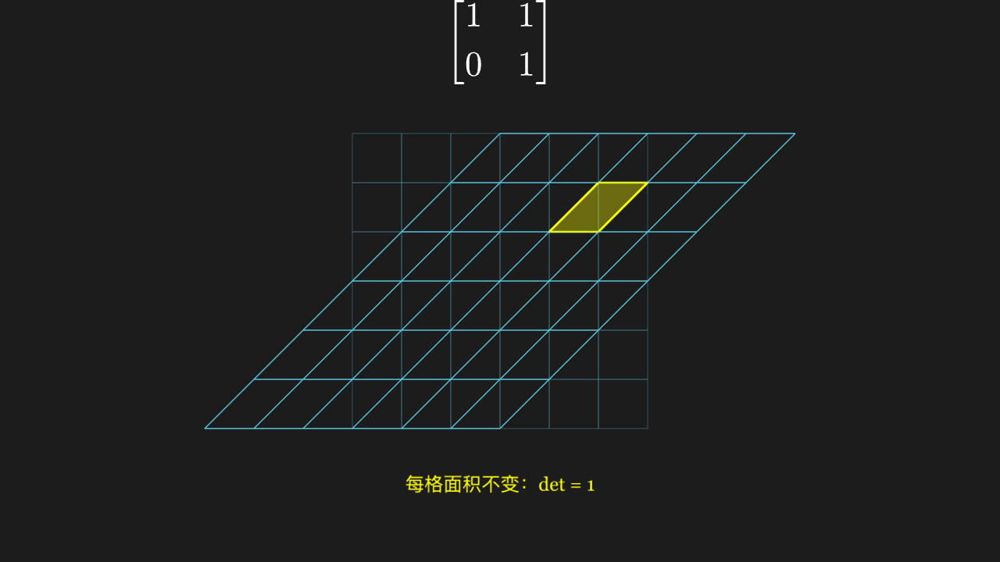

<<< @/../corpus/examples/lesson/09-linear-shear.py[Code]

:::

## Linear map: eigen directions

Vectors on an eigen direction stay on that direction after the map (red v₁ stretched 3× along the dashed line, blue v₂ unmoved) while the grey control vector u leaves its direction — deflected and undeflected side by side; the dashed lines are the two eigen directions. The three pre-image vectors stay in place as translucent ghosts, with λ₁=3 / λ₂=1 labels near the arrow tips.

::: code-group

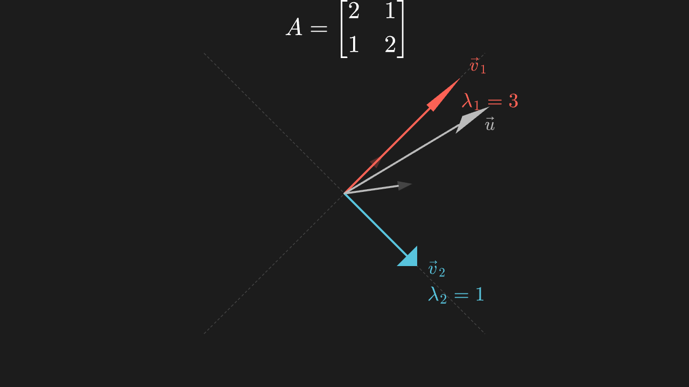

<<< @/../corpus/examples/lesson/10-eigenvector.py[Code]

:::

## Probability: frequency of dice rolls

The more rolls, the flatter the six frequency bars become (approaching uniform): six nearly equal bars (15%–18%), each measured value hovering around the orange dashed line at the theoretical 16.7%.

::: code-group

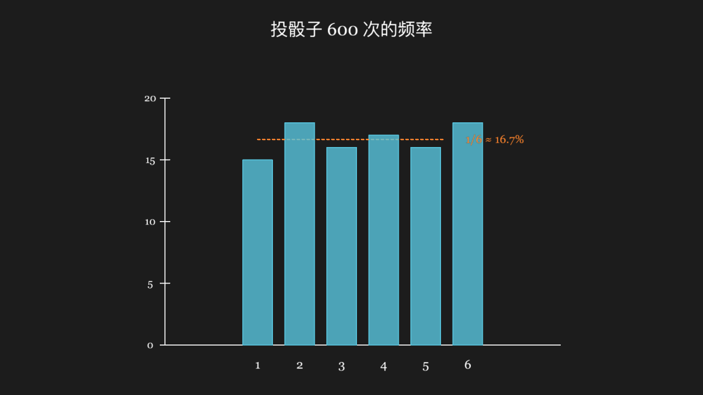

<<< @/../corpus/examples/lesson/11-probability-dice.py[Code]

:::

## Probability: binomial distribution

Two binomial pmf polylines side by side: n=10 peaks near 0.25 and n=30 near 0.14 — same p, larger n gives a shorter and wider distribution; the two-way comparison carries the claim that the parameters decide the shape.

::: code-group

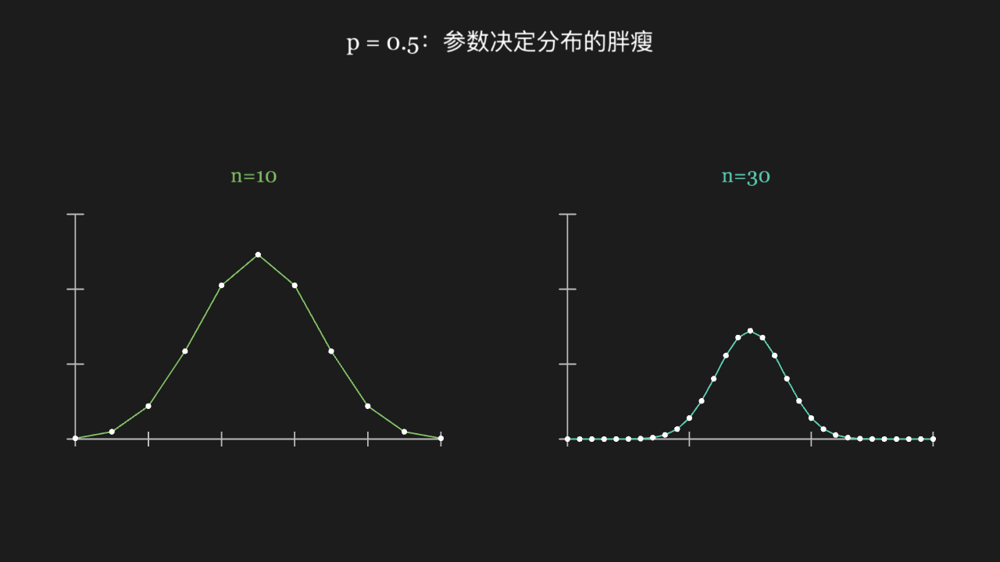

<<< @/../corpus/examples/lesson/12-probability-binomial.py[Code]

:::

## Spatial Cartesian coordinates and a cube

A cube of edge 2 seen at an angle: three faces visible at once with different shading (lit and with depth, not a black blob); it sits in the first octant with a yellow dot and label on its farthest vertex (2, 2, 2); the three axes leave the origin with Z pointing up. The title is pinned to the top-left of the frame and does not follow the camera. The camera first spins about its azimuth and then animates to the other side — the final frame shows a different set of side faces than the initial view, proving the camera really moved instead of a 2D-flattened face.

::: code-group

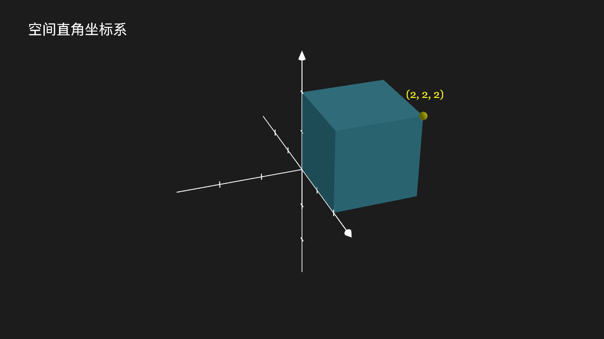

<<< @/../corpus/examples/lesson/13-space-cube-camera.py[Code]

:::
