<!-- 本文件由 scripts/gen-examples-docs.mjs 生成，不要手改：改语料或翻译表后重跑脚本。 -->

# Discrete mathematics

Truth tables, power-set lattices, relation matrices, equivalence classes, Hasse diagrams, induction, pigeonhole, bipartite graphs, colouring, minimum spanning trees, Euler and Hamilton cycles, and the Hanoi recurrence.

This page lists 12 examples. The code is imported from `corpus/examples/math-discrete/`; the screenshots are end states rendered on real machines.

## Truth table: p → q and ¬p ∨ q equivalent row by row

A five-column table with all values of p, q, ¬p, p→q and ¬p∨q filled in; the last two columns are circled together in green — identical cell by cell across all four rows, labelled equivalent on the right.

::: code-group

<<< @/../corpus/examples/math-discrete/01-truth-table.py[Code]

:::

## Power-set lattice: the 8 subsets of {1,2,3} as a cube

Eight nodes in four layers by subset size: ∅ on top, three each in the two middle layers, {1,2,3} at the bottom; edges only between nodes differing by one element. The whole shape is a planar projection of a 3-cube.

::: code-group

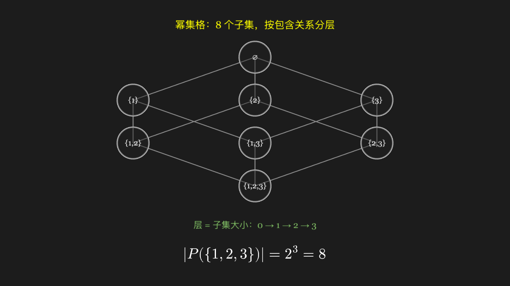

<<< @/../corpus/examples/math-discrete/02-power-set-lattice.py[Code]

:::

## Relation matrix: reading reflexivity and symmetry off a matrix

A 4×4 grid of ordered pairs on {1,2,3,4}, filled cells meaning the relation holds. A green box circles the main diagonal (reflexive) and a yellow box a pair mirrored across it (symmetric) — the pattern is unchanged when flipped.

::: code-group

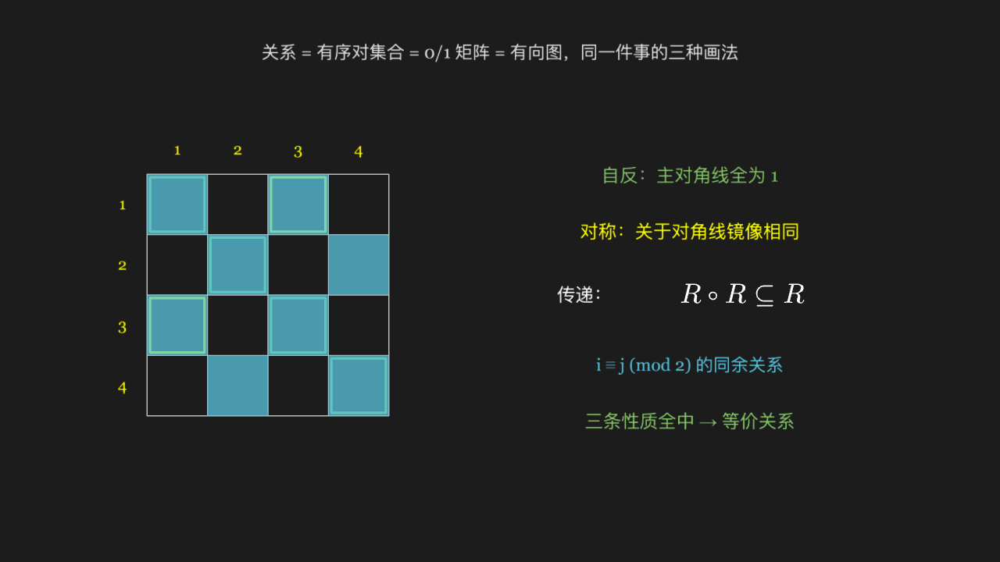

<<< @/../corpus/examples/math-discrete/03-relation-matrix.py[Code]

:::

## Equivalence classes: congruence mod 3 cuts 0–8 into three piles

The nine digits 0–8 in a line on top; below they are rearranged into three rows of three — each congruent triple grouped and circled in green, the three groups disjoint and together covering all nine digits.

::: code-group

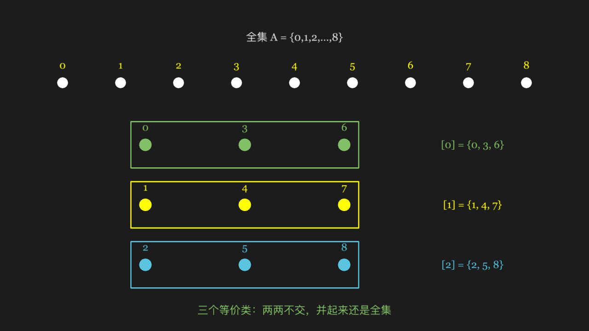

<<< @/../corpus/examples/math-discrete/04-equivalence-classes.py[Code]

:::

## Hasse diagram: only cover relations; incomparable elements at a glance

{1,2,3,6} ordered by divisibility into a diamond — 1 at the bottom, 6 at the top, 2 and 3 side by side in the middle; no edge between 2 and 3, labelled incomparable. The transitive relation from 1 to 6 is also left undrawn.

::: code-group

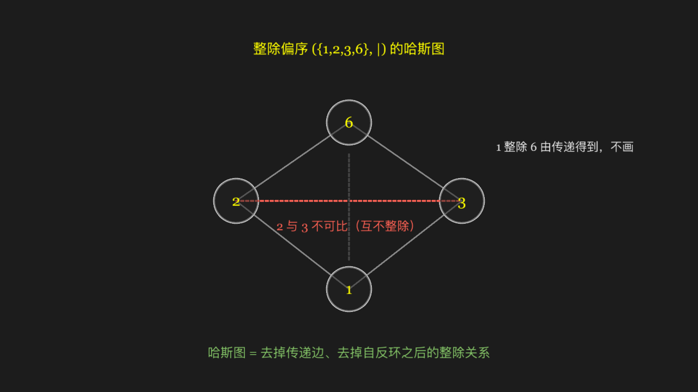

<<< @/../corpus/examples/math-discrete/05-hasse-diagram.py[Code]

:::

## The classic picture of induction: two staircases making one rectangle

The blue staircase on the left has column heights 1, 2, 3, 4 and the yellow one on the right 4, 3, 2, 1; interleaved they exactly fill a rectangle 4 wide and 5 high — so the staircase's total cell count is half of 4×5.

::: code-group

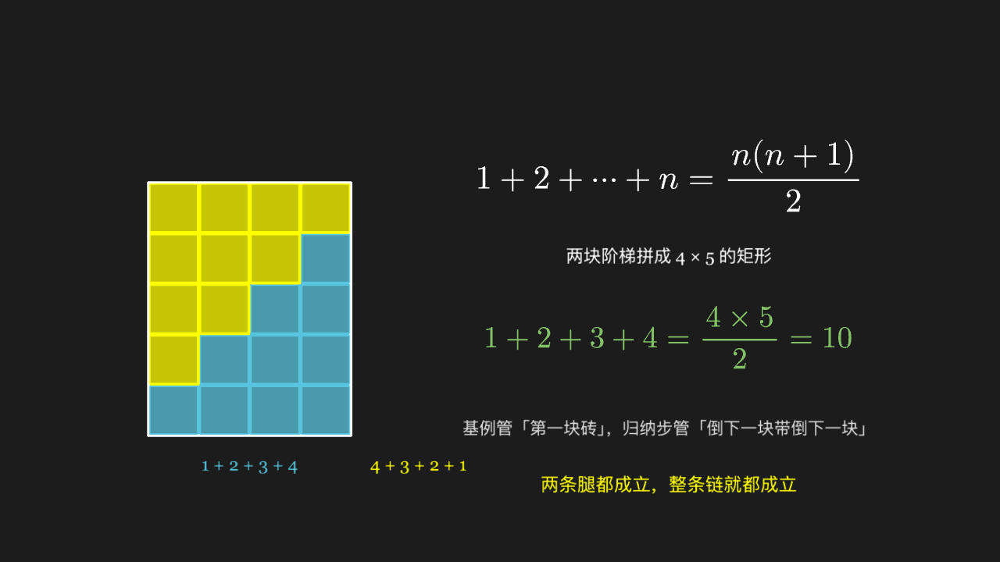

<<< @/../corpus/examples/math-discrete/06-mathematical-induction.py[Code]

:::

## Pigeonhole principle: 13 pigeons into 12 holes

Twelve holes each take one pigeon first, leaving one with nowhere to go; when it lands in the first hole a red circle marks it — the holes are used up, so some hole must hold two.

::: code-group

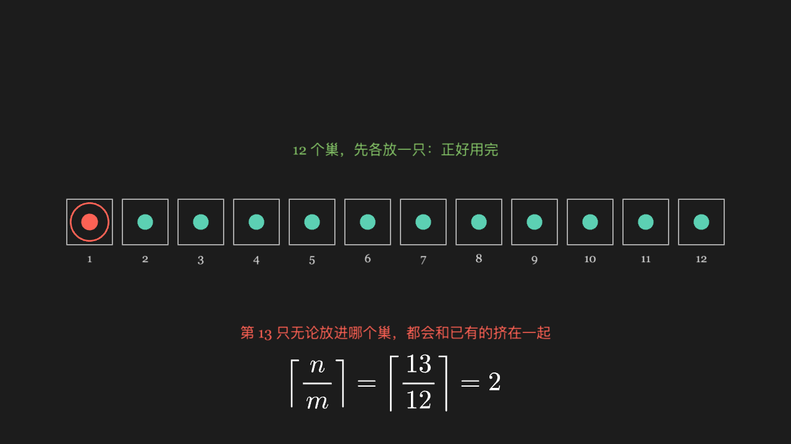

<<< @/../corpus/examples/math-discrete/07-pigeonhole.py[Code]

:::

## Bipartite graphs: vertices split in two, edges only across

Six vertices in a blue and a yellow column on the left with all six edges crossing from blue to yellow and none inside a column; a triangle on the right as the counterexample — an odd cycle of three edges head to tail.

::: code-group

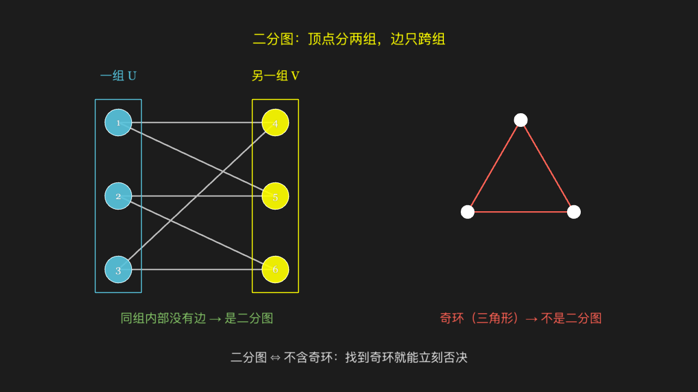

<<< @/../corpus/examples/math-discrete/08-bipartite-graph.py[Code]

:::

## Graph colouring: adjacent vertices differ; how few colours suffice

On the left a 5-cycle where red and blue alone collide at the closure, forcing a third colour (green); on the right four mutually adjacent vertices that need all four colours however arranged.

::: code-group

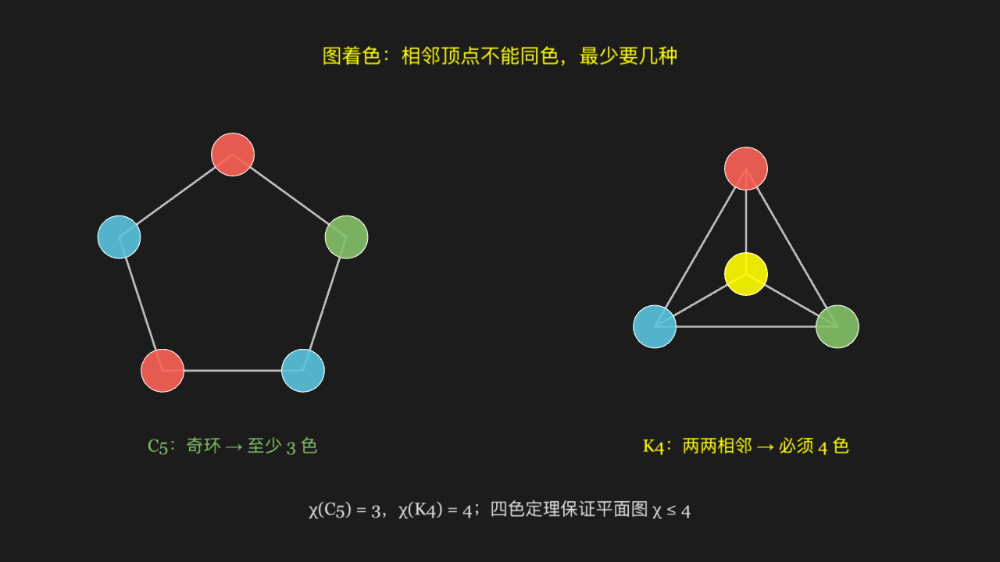

<<< @/../corpus/examples/math-discrete/09-graph-coloring.py[Code]

:::

## Minimum spanning tree: add edges by weight, drop those that close a cycle

All 8 weighted edges first laid faintly over six vertices, then judged in weight order 1→8 — adopted edges light up green (5 of them, exactly connecting the 6 points into a tree), cycle-forming edges turn red and dashed. The 5 green edges total weight 19.

::: code-group

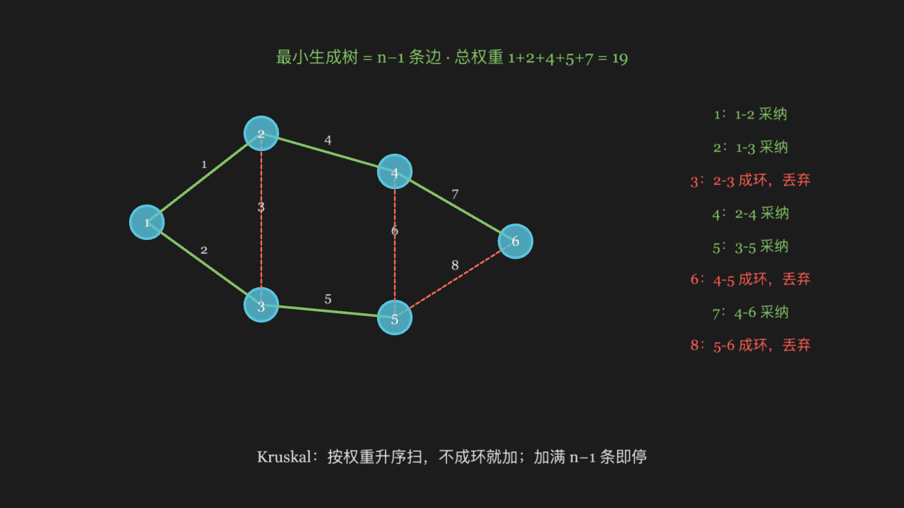

<<< @/../corpus/examples/math-discrete/10-spanning-tree.py[Code]

:::

## Euler vs Hamilton cycles: one counts edges, the other counts vertices

On the left two triangles sharing a vertex: the centre vertex has degree 4 and the rest 2, all even, so every edge can be traversed exactly once in one stroke (Euler cycle), but visiting every vertex exactly once is impossible. On the right a quadrilateral with one diagonal: the outer ring visits all four vertices (Hamilton cycle), but two vertices have degree 3, so no Euler cycle exists.

::: code-group

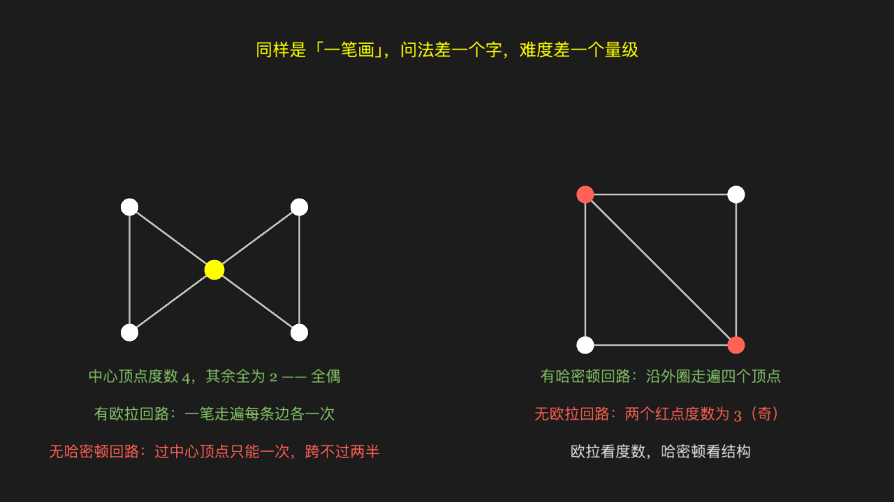

<<< @/../corpus/examples/math-discrete/11-euler-hamilton.py[Code]

:::

## The Hanoi recurrence: T(n) = 2T(n−1) + 1, hence 2ⁿ − 1

Three pegs at the bottom left with three discs stacked small-to-large on the first; the bar chart on the right gives the move counts for n=1 to 8. Bar heights scale by log₂(T+1), so the picture rises in perfectly even steps — a straight line standing for genuine exponential growth.

::: code-group

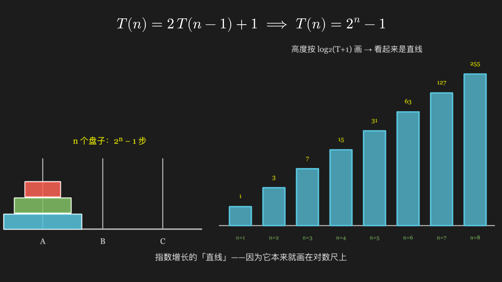

<<< @/../corpus/examples/math-discrete/12-hanoi-recurrence.py[Code]

:::
