<!-- 本文件由 scripts/gen-examples-docs.mjs 生成，不要手改：改语料或翻译表后重跑脚本。 -->

# Probability and statistics

Inclusion–exclusion, conditional probability, Bayes trees, expectation and variance, the law of large numbers, the central limit theorem, Poisson arrivals, the 3σ rule, Monte Carlo π, random walks and hypothesis tests.

This page lists 12 examples. The code is imported from `corpus/examples/math-prob/`; the screenshots are end states rendered on real machines.

## Addition rule (inclusion–exclusion): P(A∪B) = P(A) + P(B) - P(A∩B)

Inside the sample space Ω two translucent rectangular events A and B overlap, the overlap mixing into an intermediate colour; A∩B is lit separately with a red stroked frame and a letter label, then the formula shows it is exactly the part counted twice.

::: code-group

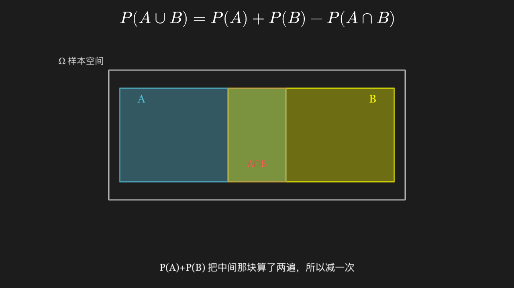

<<< @/../corpus/examples/math-prob/01-inclusion-exclusion.py[Code]

:::

## Conditional probability: renormalizing on a new sample space

Event A is cut in two by B's boundary; the half inside B is lit first, then everything outside B dims as a whole and only the interior of B is rescaled proportionally.

::: code-group

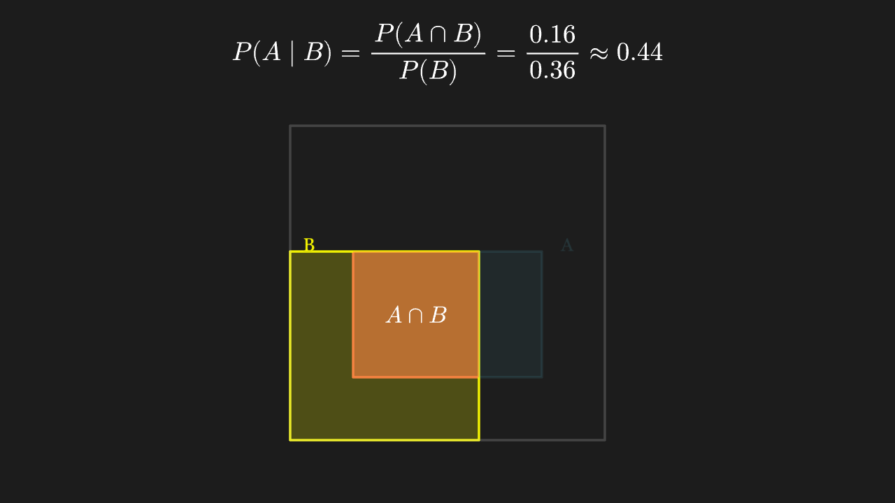

<<< @/../corpus/examples/math-prob/02-conditional-probability.py[Code]

:::

## Bayes' formula: a tree combining prior and likelihood into posterior

A two-level branching tree on the left lays out the two routes sick 1% × detected 99% and healthy 99% × false alarm 5%; the right lists both joint probabilities — the green total positive probability is the denominator and the red route's share is the posterior.

::: code-group

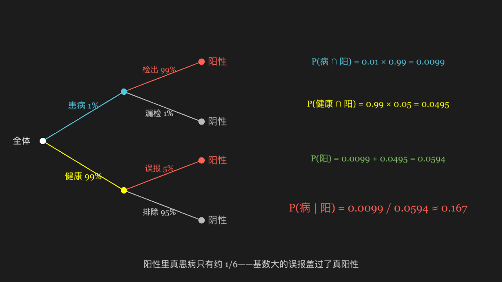

<<< @/../corpus/examples/math-prob/03-bayes-tree.py[Code]

:::

## Expectation: the centre of mass of a distribution, and this lever's fulcrum

Blocks whose heights are proportional to probabilities stand at six values, and the lever balances exactly at the weighted mean μ=3.6 — not at the arithmetic centre 3.5.

::: code-group

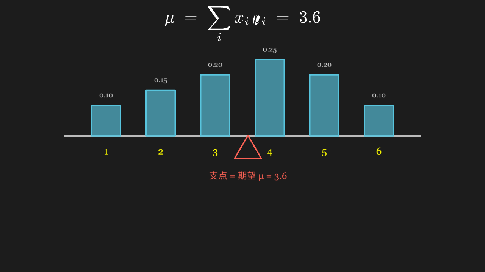

<<< @/../corpus/examples/math-prob/04-expectation-balance.py[Code]

:::

## Variance measures spread: same expectation, different scatter

Two data sets share one number line and one mean tick, yet one crowds into a clump while the other spreads wide; two range bars with end ticks mark each spread, and the visual gap corresponds directly to variances 2 and 200.

::: code-group

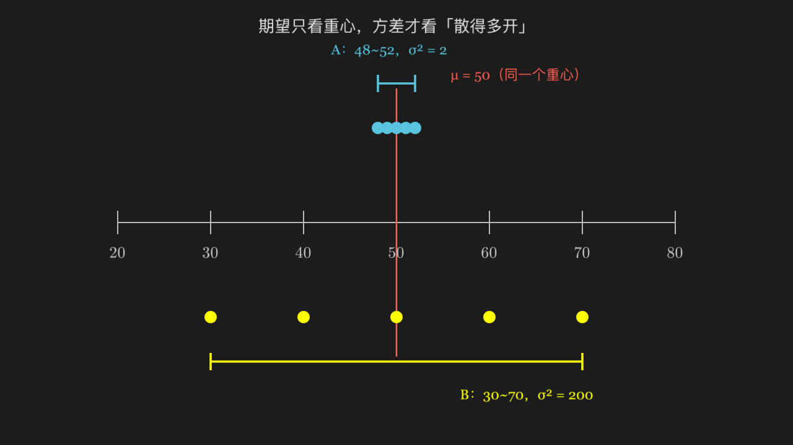

<<< @/../corpus/examples/math-prob/05-variance-spread.py[Code]

:::

## Law of large numbers: frequency settling onto the true probability

A polyline starts with violent oscillation and narrows towards the dashed line y=0.5 as trials accumulate — convergence holds with probability 1, not monotonically at every step.

::: code-group

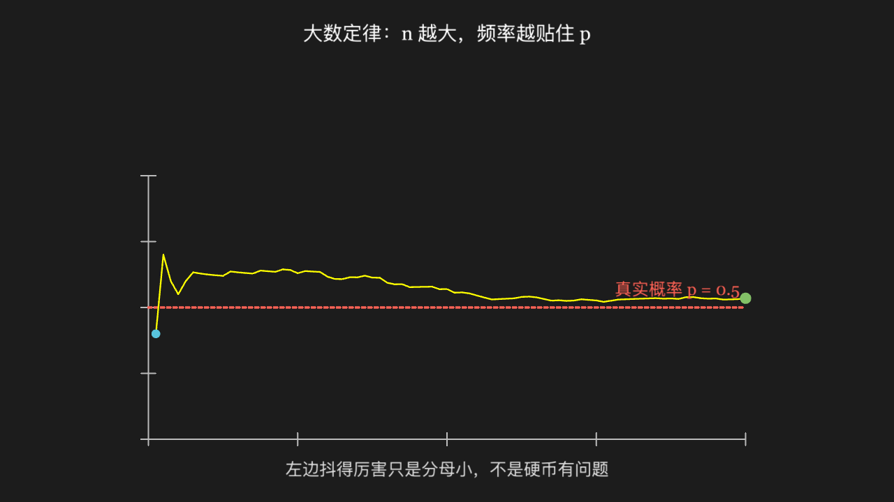

<<< @/../corpus/examples/math-prob/06-law-of-large-numbers.py[Code]

:::

## Central limit theorem: sums of i.i.d. variables approach the normal shape

Three histograms side by side: one die (flat), the sum of two (triangular), the sum of four (clearly bell-shaped); the right two pile towards the middle with collapsing tails, normalized to equal height so the shapes compare.

::: code-group

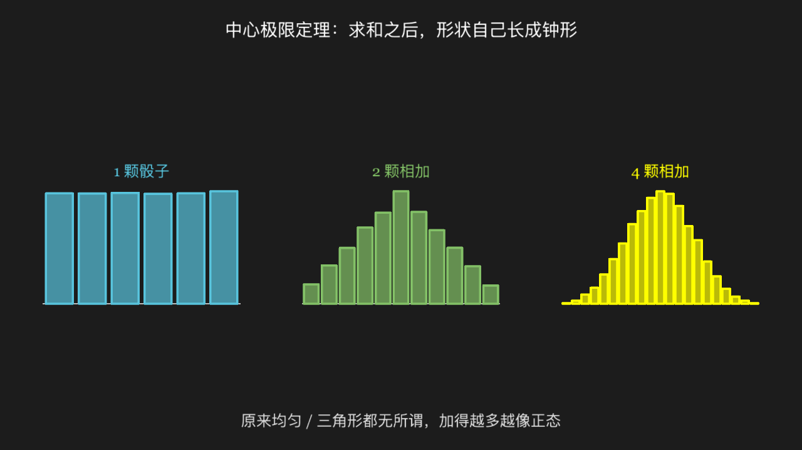

<<< @/../corpus/examples/math-prob/07-central-limit-theorem.py[Code]

:::

## Poisson distribution: rare-event arrivals on a time axis

Arrival times scattered unevenly along a time axis (events cannot overlap), beside the count distribution bars: highest around k=2, 3 and decaying fast at both ends.

::: code-group

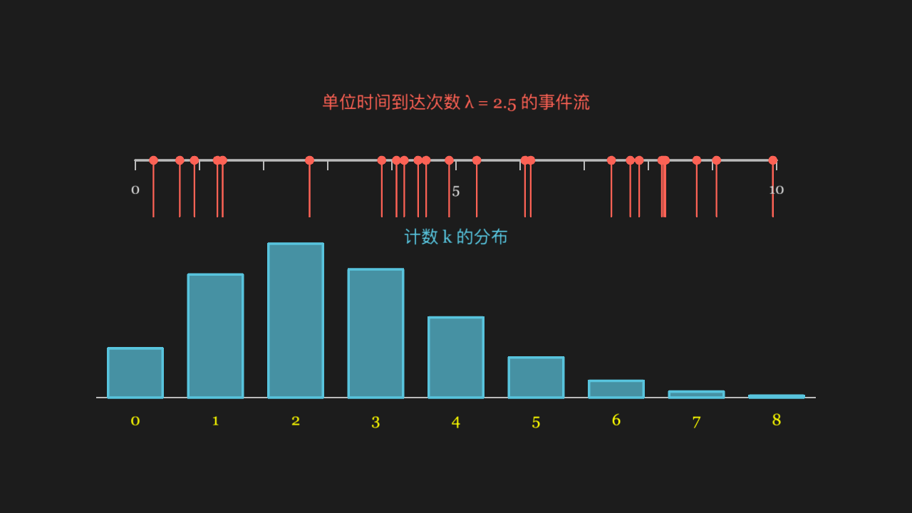

<<< @/../corpus/examples/math-prob/08-poisson-arrivals.py[Code]

:::

## The 3σ rule of the normal distribution: how the area under the bell splits

Dashed cuts at ±1σ, ±2σ and ±3σ under the bell with the covered areas listed on the right; below, 1000 sample dots crowd the middle and the few beyond ±2.5σ are coloured red.

::: code-group

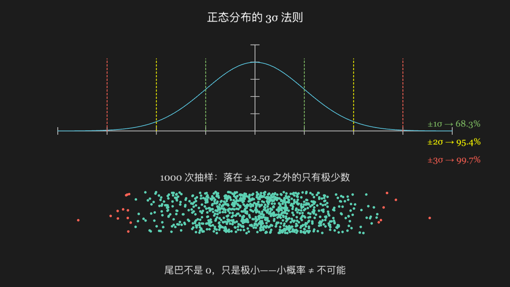

<<< @/../corpus/examples/math-prob/09-normal-sigma.py[Code]

:::

## Monte Carlo estimate of π: scatter points and count those inside the quarter circle

A quarter circle inside a square of side 2 with blue points scattered at random: those inside the arc turn yellow, the rest stay blue; the bottom-right readout shows the running ratio times 4 approaching 3.14.

::: code-group

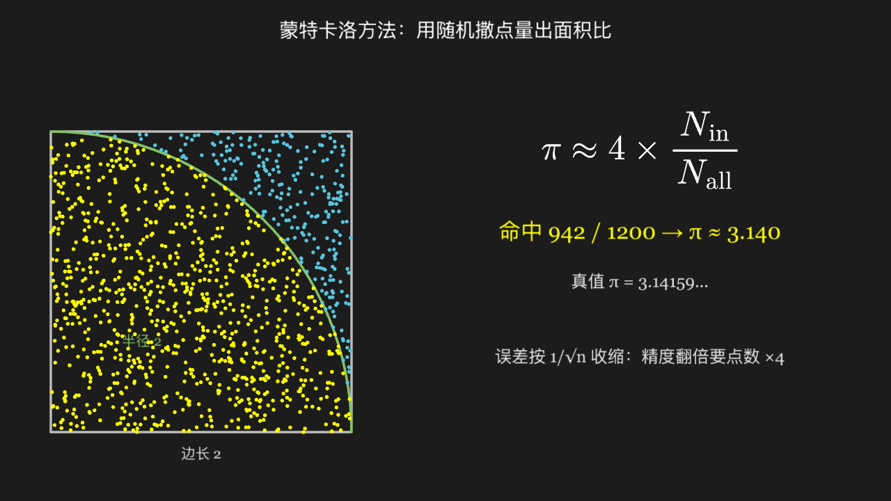

<<< @/../corpus/examples/math-prob/10-monte-carlo-pi.py[Code]

:::

## Random walk: memoryless steps, yet a √n scale overall

Four independent one-dimensional walks leave the origin together, each wandering out of sync; the endpoints are marked and the horizontal envelope around them is far narrower than the step count — the typical scale is √n, not n.

::: code-group

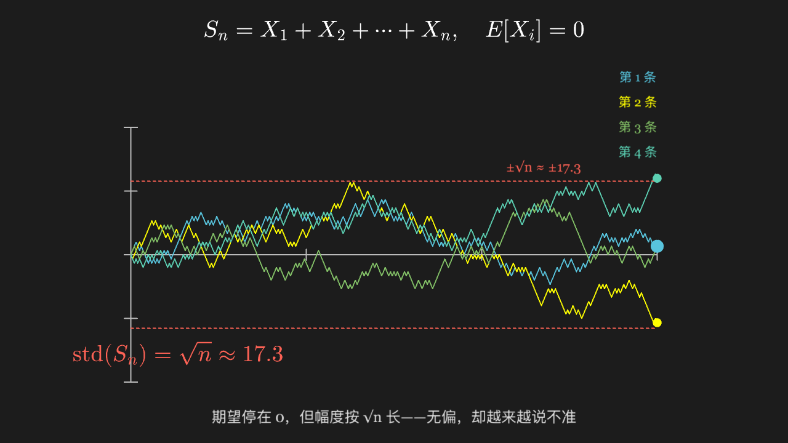

<<< @/../corpus/examples/math-prob/11-random-walk.py[Code]

:::

## The two errors of hypothesis testing: α rejects the true, β accepts the false

Two offset bell curves stand for H0 and H1; H0's right tail is cut into a red region (type I / false positive) and H1's left tail into a yellow region (type II / false negative), with the vertical line between them as the rejection threshold.

::: code-group

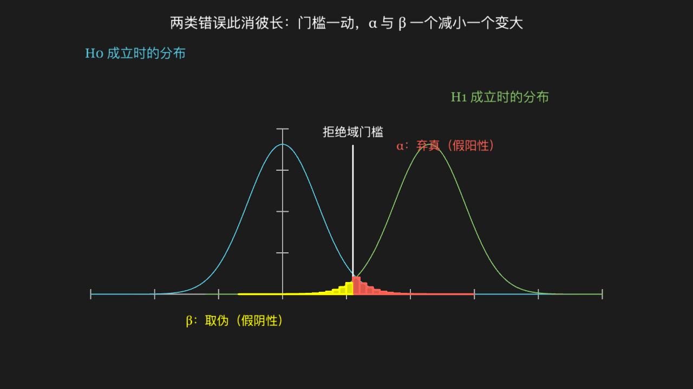

<<< @/../corpus/examples/math-prob/12-hypothesis-test.py[Code]

:::
