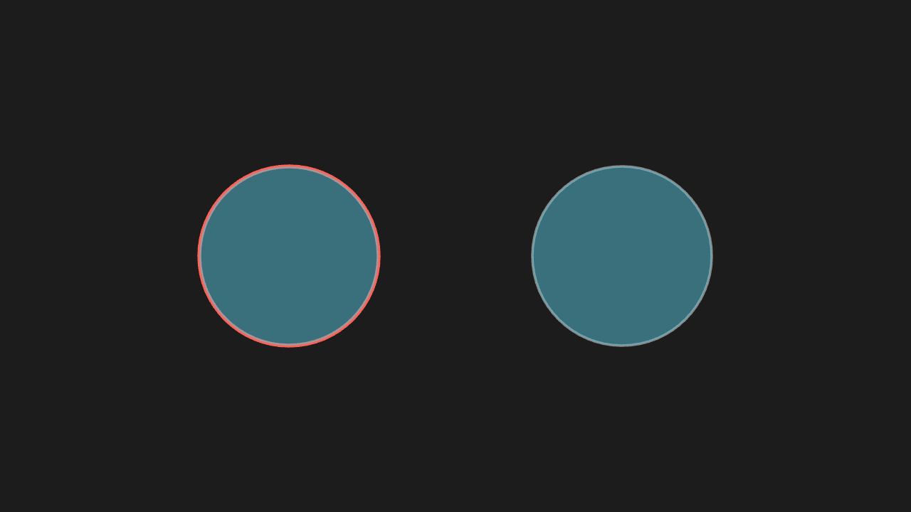
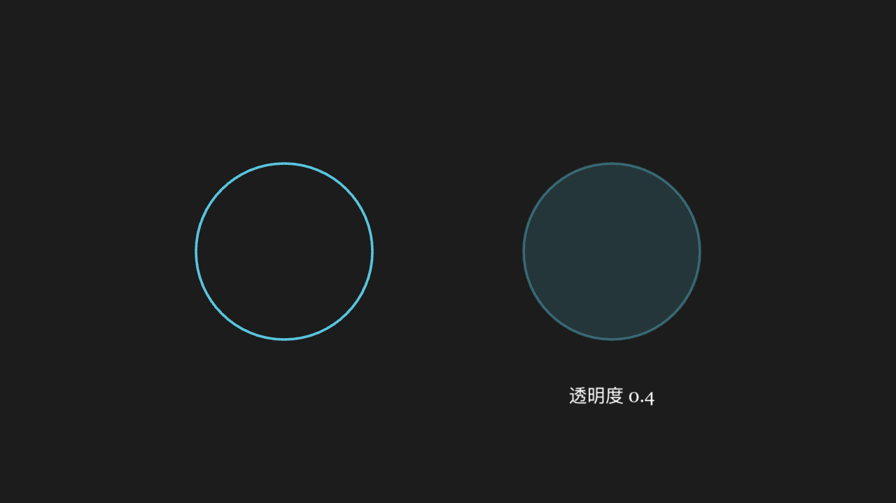
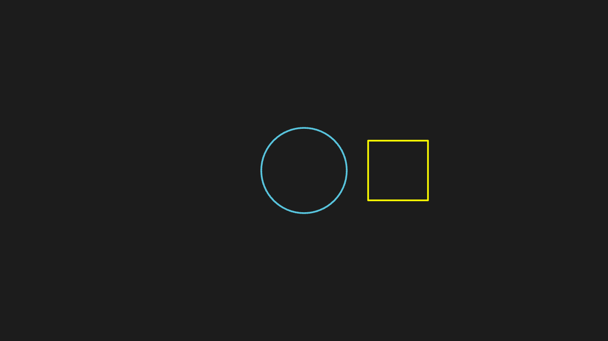
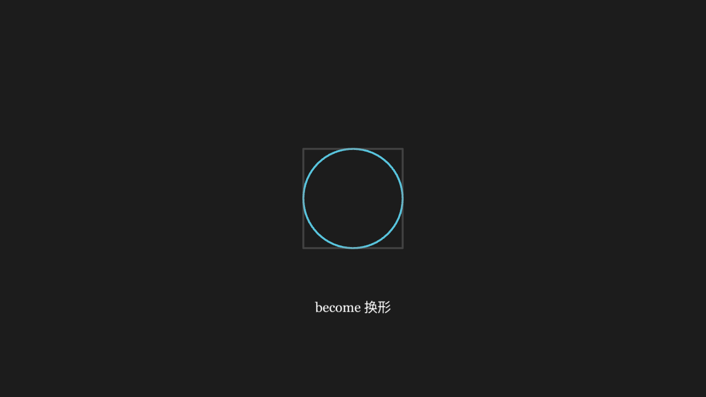
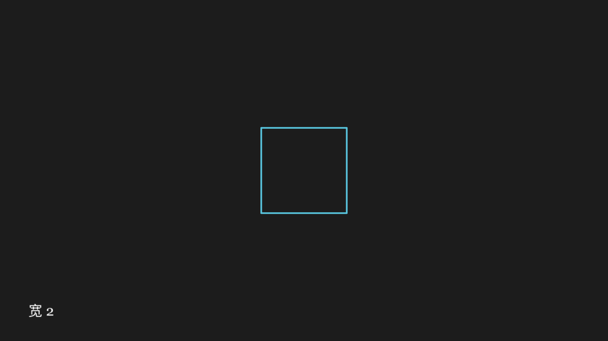
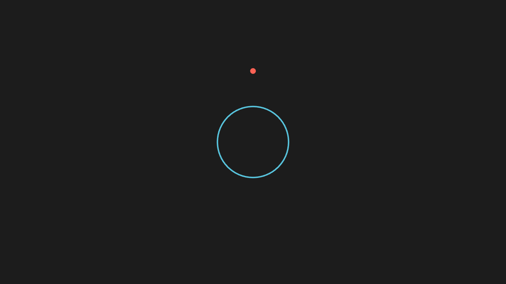
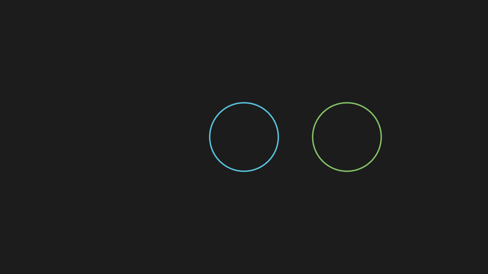

<!-- 本文件由 scripts/gen-examples-docs.mjs 生成，不要手改：改语料或翻译表后重跑脚本。 -->

# Methods and rewrites

Style rewrites such as set_stroke / set_fill, transform chains like shift / rotate, and the boundaries of save_state / restore and copy.

This page lists 13 examples. The code is imported from `corpus/examples/method/`; the screenshots are end states rendered on real machines.

## set_stroke (mapped to setStyle)

Only the stroke changes (width / colour) while the fill stays as it was — set_stroke wiping the fill was a fixed incident and this case pins it.

::: code-group

<<< @/../corpus/examples/method/01-set-stroke.py[Code]

:::

## set_opacity (split into stroke + fill)

Stroke and fill fade together; the colour is unchanged.

::: code-group

<<< @/../corpus/examples/method/02-set-opacity.py[Code]

:::

## set_fill keyword opacity

The fill becomes the given colour with the given opacity; the stroke is untouched.

::: code-group

<<< @/../corpus/examples/method/03-set-fill.py[Code]

:::

## put_start_and_end_on (Line in two steps)

The line's two ends land exactly on the two given points.

::: code-group

<<< @/../corpus/examples/method/04-put-start-and-end-on.py[Code]

:::

## next_to with buff

The gap between the two mobjects matches the buff value — neither touching nor too far apart.

::: code-group

<<< @/../corpus/examples/method/05-next-to-buff.py[Code]

:::

## to_edge / to_corner

The mobject sticks to the given edge or corner, keeping a buff from the border.

::: code-group

<<< @/../corpus/examples/method/06-edge-corner.py[Code]

:::

## shift / move_to / scale / rotate chain

The four calls chain in order; the final position and orientation match the chain.

::: code-group

<<< @/../corpus/examples/method/07-process-family.py[Code]

:::

## arrange_in_grid

A set of mobjects laid out in a tidy grid with the requested rows, columns and spacing.

::: code-group

<<< @/../corpus/examples/method/08-arrange-grid.py[Code]

:::

## save_state / restore

After the changes, restore returns the mobject to its save_state look — position, size and style all back.

::: code-group

<<< @/../corpus/examples/method/09-save-restore.py[Code]

:::

## become swaps the shape

After playback the mobject has become the target shape; become replaces rather than copies.

::: code-group

<<< @/../corpus/examples/method/10-become.py[Code]

:::

## Reading the width attribute

The printed width matches the mobject's real width (the numeric assertion is authoritative).

::: code-group

<<< @/../corpus/examples/method/11-attr-read.py[Code]

:::

## get_center used for placement

A mobject placed with get_center's return value has its centre exactly where expected.

::: code-group

<<< @/../corpus/examples/method/12-get-center.py[Code]

:::

## copy produces a new mobject

Changing the copy leaves the original untouched — the two are independent and share no style.

::: code-group

<<< @/../corpus/examples/method/13-copy.py[Code]

:::
