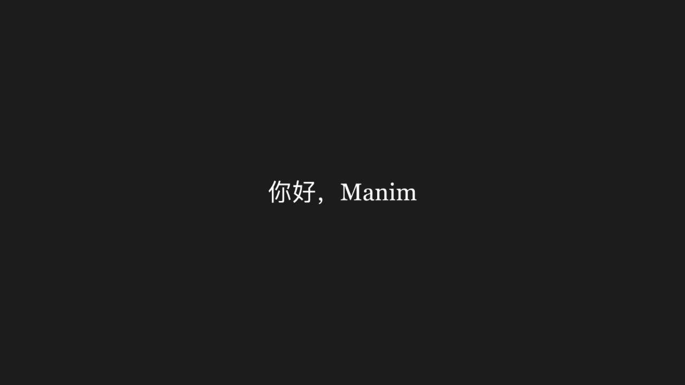
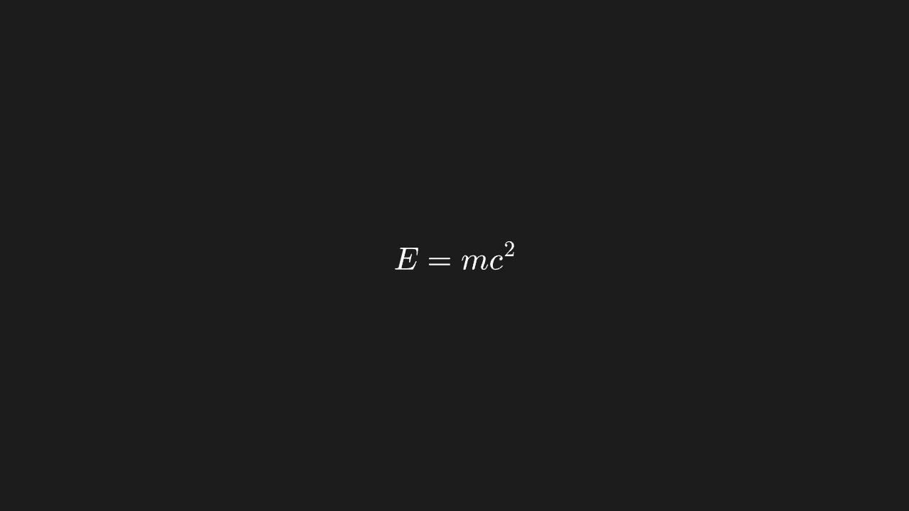
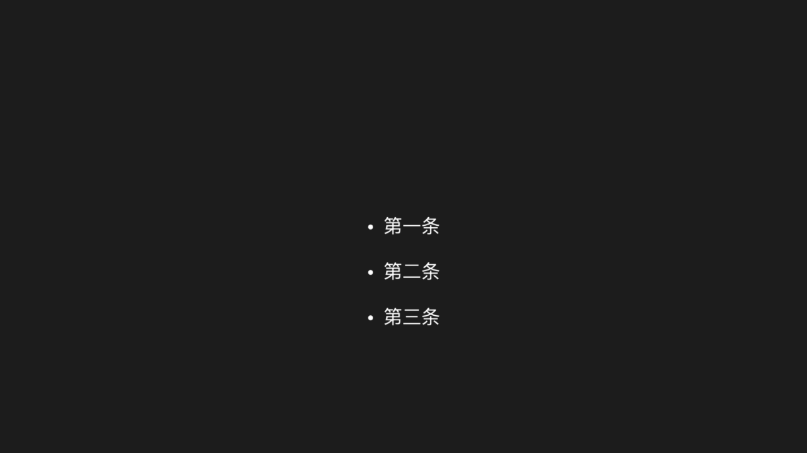
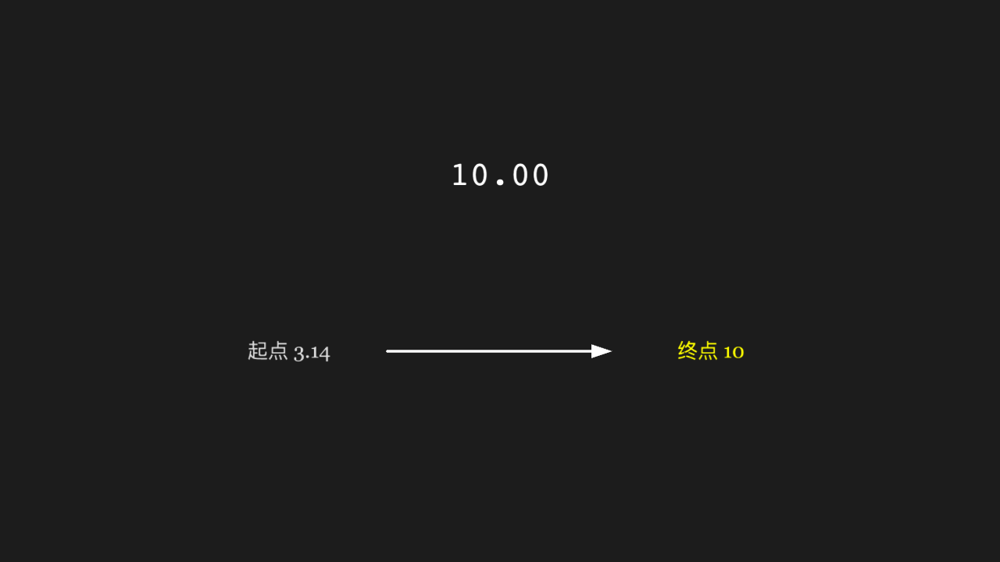
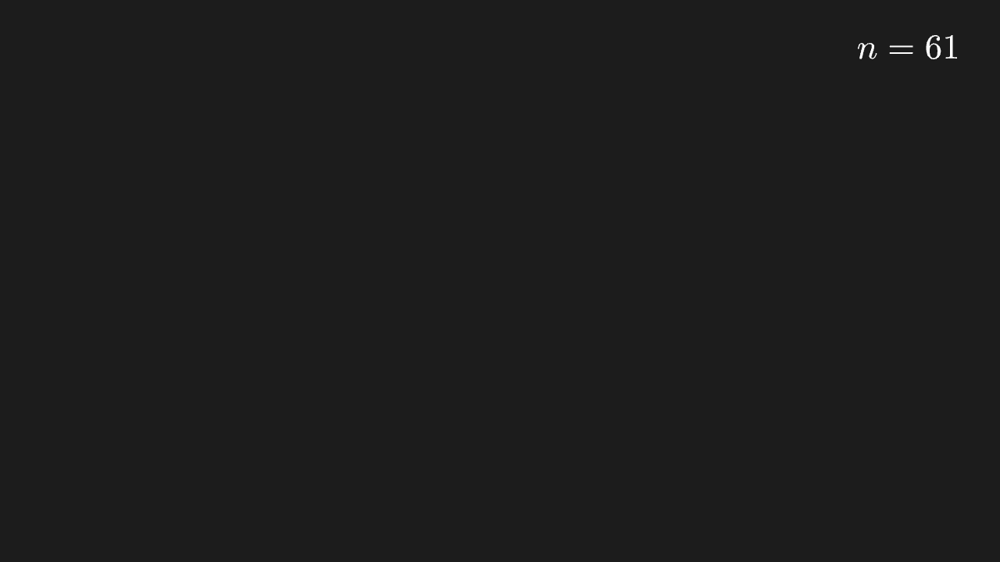
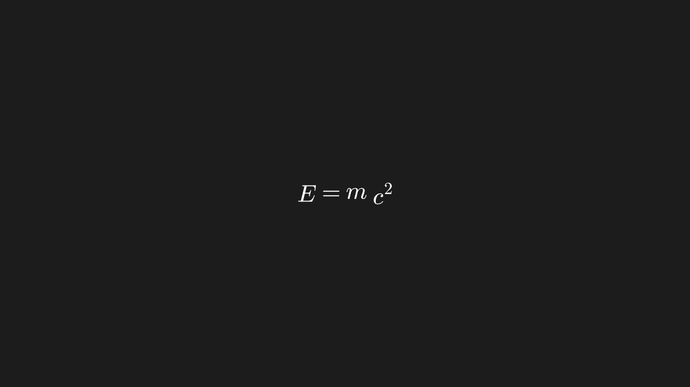

<!-- 本文件由 scripts/gen-examples-docs.mjs 生成，不要手改：改语料或翻译表后重跑脚本。 -->

# Text and formulas

Rendering and typesetting of Text / MathTex / Tex / MarkupText, plus lists, wrapping, underlines, number animations and titles.

This page lists 11 examples. The code is imported from `corpus/examples/text/`; the screenshots are end states rendered on real machines.

## Text

Text renders with real glyphs (no boxes or mojibake); the content matches.

::: code-group

<<< @/../corpus/examples/text/01-basic.py[Code]

:::

## MathTex fraction and root

The fraction has its bar and the root covers its radicand, in math typesetting.

::: code-group

<<< @/../corpus/examples/text/02-mathtex-frac.py[Code]

:::

## Tex takes a LaTeX string

A whole LaTeX string typeset as a formula with normal fonts and spacing.

::: code-group

<<< @/../corpus/examples/text/03-tex-plain.py[Code]

:::

## MarkupText rich text

Local bold / colour changes in the rich text take effect; the rest is unaffected.

::: code-group

<<< @/../corpus/examples/text/04-markup.py[Code]

:::

## BulletedList

Each list line carries a bullet and the line spacing is even.

::: code-group

<<< @/../corpus/examples/text/05-bulleted-list.py[Code]

:::

## Paragraph auto-wraps

A long string wraps into several lines without exceeding the line width.

::: code-group

<<< @/../corpus/examples/text/06-paragraph.py[Code]

:::

## Underline

A line under the text, its length matching the text.

::: code-group

<<< @/../corpus/examples/text/07-underline.py[Code]

:::

## DecimalNumber animation

A number animation: digit and decimal counts follow the parameters and the value changes continuously during playback.

::: code-group

<<< @/../corpus/examples/text/08-decimal-number.py[Code]

:::

## Two-digit label at the top-right corner

A two-digit label sits at the target's top-right corner, inside the frame and off the target (a fixed positioning incident).

::: code-group

<<< @/../corpus/examples/text/09-mathtex-corner.py[Code]

:::

## MathTex multiple positional parts

Several parts laid out on one line with sensible spacing and the given order.

::: code-group

<<< @/../corpus/examples/text/10-mathtex-parts.py[Code]

:::

## Title

The title appears centred at the top of the frame, larger than body text.

::: code-group

<<< @/../corpus/examples/text/11-title.py[Code]

:::
