<!-- 本文件由 scripts/gen-examples-docs.mjs 生成，不要手改：改语料或翻译表后重跑脚本。 -->

# 动画

m.animate 链、速率函数、Transform 一族、入场与高亮动画、沿路径运动与描边后填充。

本页 17 条示例。代码引自 `corpus/examples/animate/`，截图为真机渲染的终态。

## m.animate 链式

方块先挪到右侧、再变色再放大（链上多个变更一起落到终态），过程平滑。

::: code-group

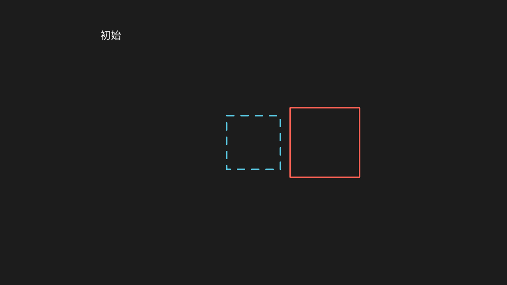

<<< @/../corpus/examples/animate/01-chain.py[代码]

:::

## animate 链里改填充

动画结束物体的填充色变成目标色，且是「渐变过去」不是瞬间跳变。

::: code-group

<<< @/../corpus/examples/animate/02-chain-fill.py[代码]

:::

## 速率与时长（rate_func 对照）

两个物体从左到右位移同样距离、run_time 相同，一个 rate_func=linear、一个 rate_func=smooth，各自旁标注速率名；画面留两条路径的起终点标记。急缓差异（smooth 两头慢中间快）是过程性的——真时序观察；终帧以 「路径 + 起终点标记 + 速率名标注」的对照定格作证。

::: code-group

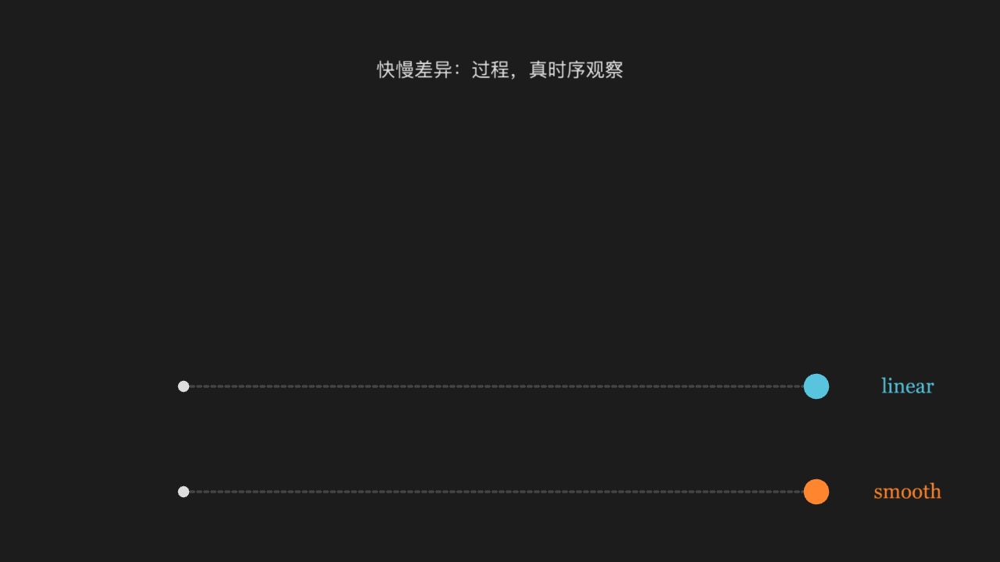

<<< @/../corpus/examples/animate/03-rate-func.py[代码]

:::

## there_and_back 速率

物体走到目标后又原路折返回起点（there_and_back 的标志性行为）。折返是过程性的——真时序观察；终帧圆回到起点，目标点与虚线路径留在画面上作证据，圆旁标注 there_and_back。

::: code-group

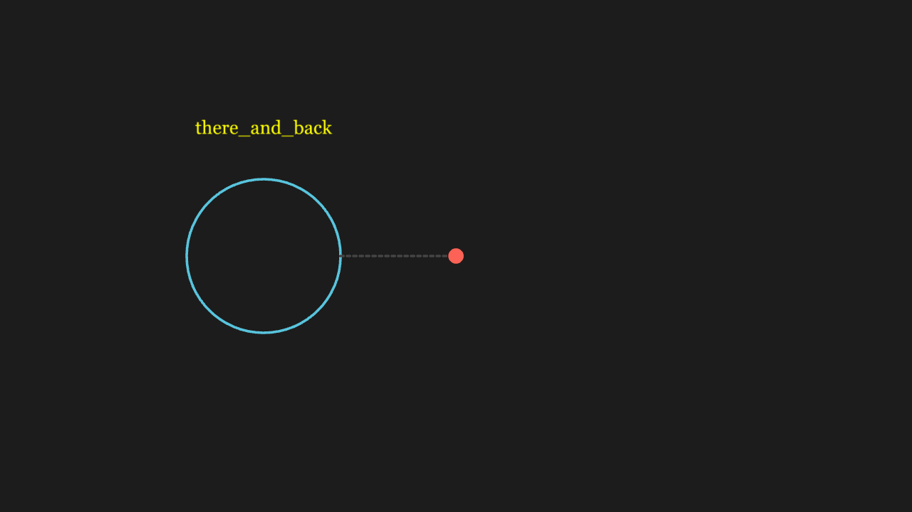

<<< @/../corpus/examples/animate/04-rate-variants.py[代码]

:::

## Transform 变形

A 物体连续变形为 B 物体（形状与位置同时插值），过程中两者都是同一个物体。

::: code-group

<<< @/../corpus/examples/animate/05-transform.py[代码]

:::

## ReplacementTransform 换掉旧物体

变形结束后场景里是 B、A 被换掉——后续再动 A 不会再出现。

::: code-group

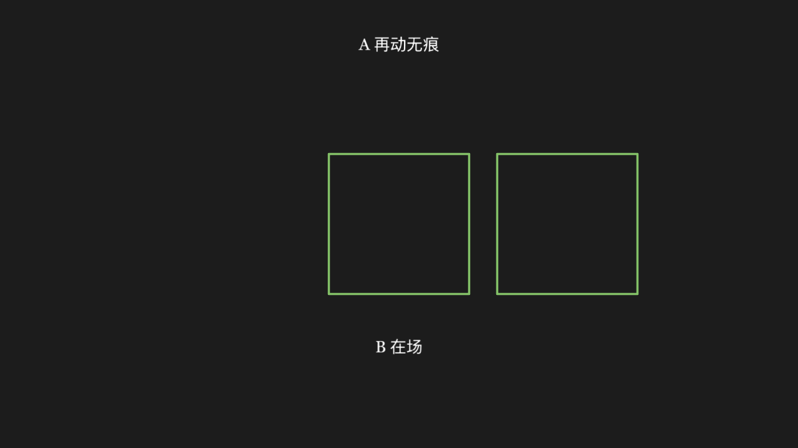

<<< @/../corpus/examples/animate/06-replacement-transform.py[代码]

:::

## TransformMatchingTex 公式变换

公式里相同的片段原地不动、不同的片段移动补位，不是整串打碎重排 （黄色 = 从 a = b 到 x = y 位置不变，a→x、b→y 补位）。

::: code-group

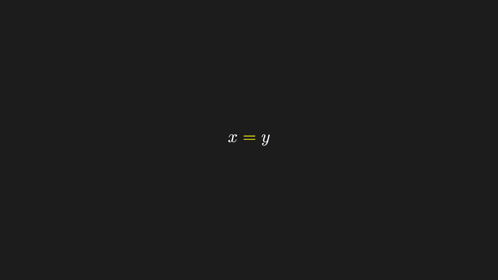

<<< @/../corpus/examples/animate/07-transform-matching-tex.py[代码]

:::

## LaggedStart 依次入场

多个物体依次入场，彼此有先后错峰（lag_ratio 决定重叠程度）。

::: code-group

<<< @/../corpus/examples/animate/08-lagged-start.py[代码]

:::

## AnimationGroup 并行

组里的几个动画同时进行、同时结束，不逐个来。

::: code-group

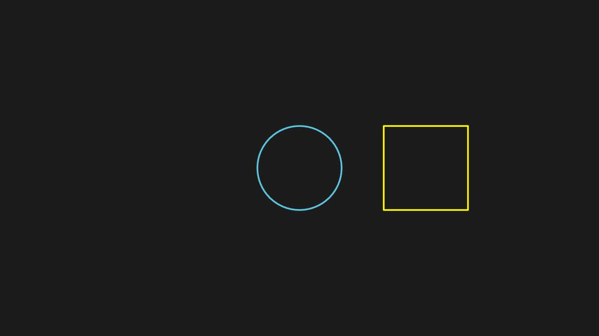

<<< @/../corpus/examples/animate/09-animation-group.py[代码]

:::

## Indicate / Flash / Circumscribe

Indicate 是原地缩放闪一下、Flash 是某点迸一下光、Circumscribe 是绕物体画个圈，三者形态不同。三段高亮都是过程性的——真时序观察；终帧以名字标注区分三者，并给 Circumscribe 留一圈（动画后显式 add 手算 Rectangle）作证。

::: code-group

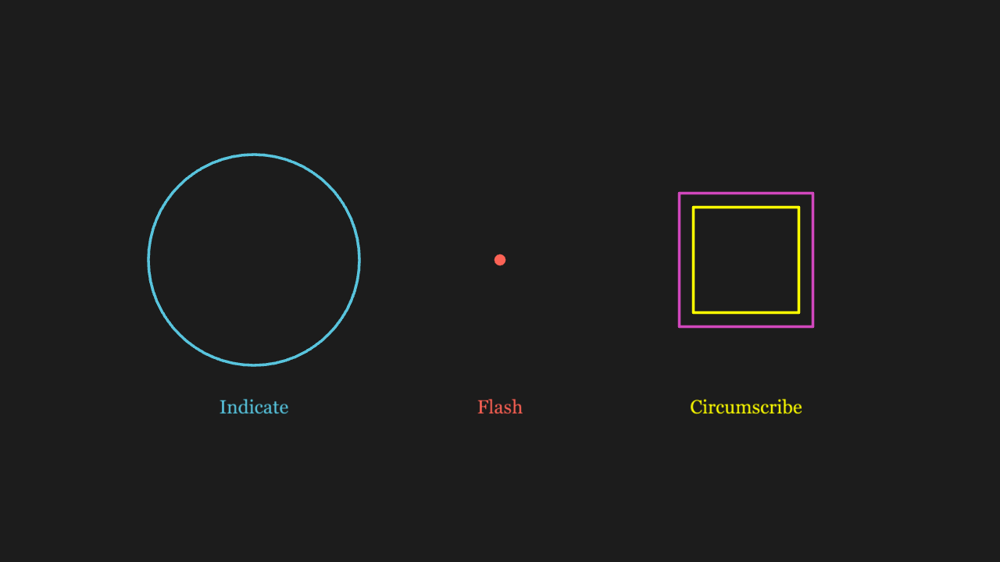

<<< @/../corpus/examples/animate/10-indicate-family.py[代码]

:::

## MoveAlongPath 沿路径走

点贴着给定路径曲线走，不是走直线。

::: code-group

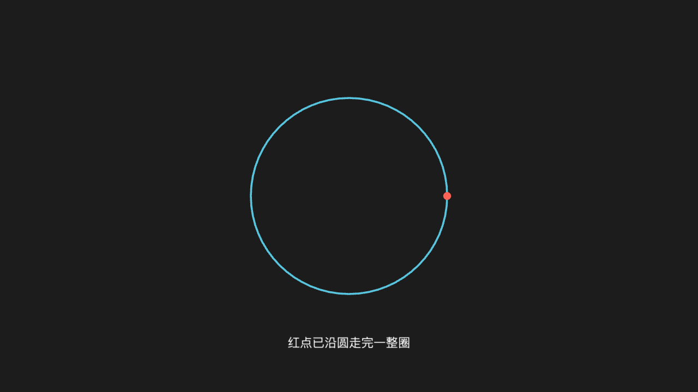

<<< @/../corpus/examples/animate/11-move-along-path.py[代码]

:::

## Rotating 绕轴转

物体绕指定轴连续转过去（多圈/指定角度），不是瞬间转到位。

::: code-group

<<< @/../corpus/examples/animate/12-rotating.py[代码]

:::

## ScaleInPlace 缩放

物体原地放大或缩小，中心不动。

::: code-group

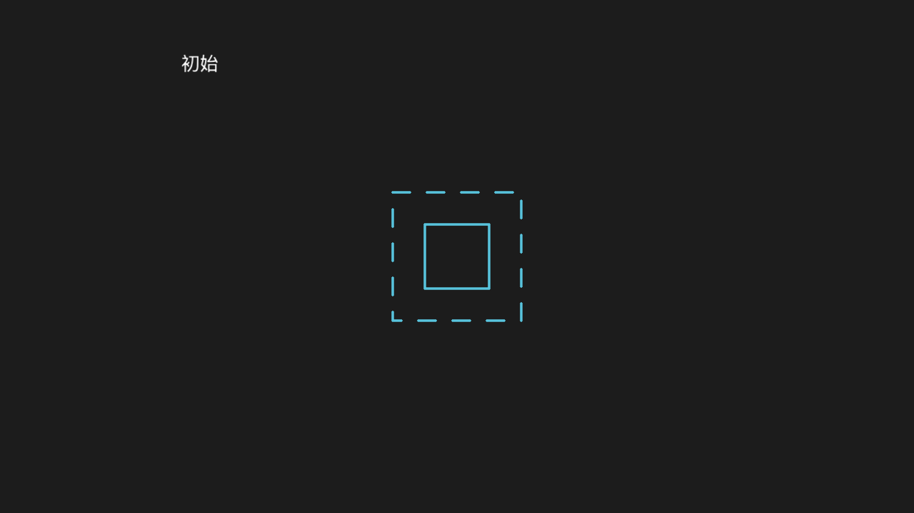

<<< @/../corpus/examples/animate/13-scale-in-place.py[代码]

:::

## DrawBorderThenFill 描边后填充

先只描出轮廓线，随后填充色才填进来——两个阶段看得出来。「轮廓先行、填充后到」是过程性的——真时序观察；适配层在动画终态不落填充，故动画后再补一条 set_fill 动画，终帧为填满黄色的方块。

::: code-group

<<< @/../corpus/examples/animate/14-draw-border.py[代码]

:::

## ApplyMatrix 矩阵变换

物体被矩阵扭曲出斜切/旋转形变，不是平移或等比缩放。

::: code-group

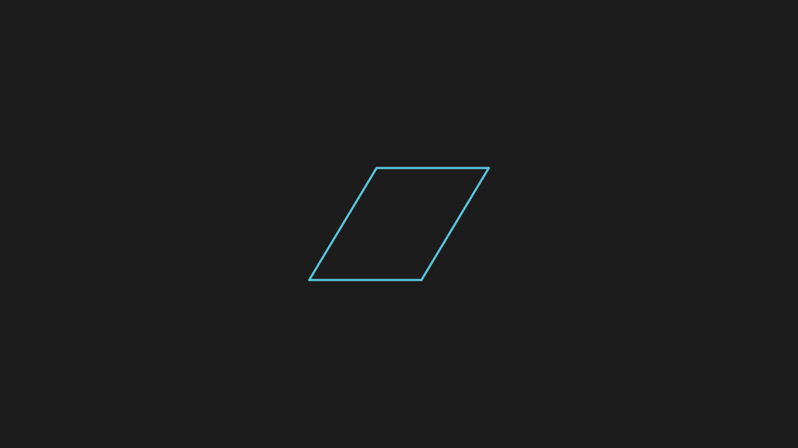

<<< @/../corpus/examples/animate/15-apply-matrix.py[代码]

:::

## FadeIn / FadeOut

FadeIn 是从透明渐显、FadeOut 是渐隐到消失，其余状态不变。渐显/渐隐是过程性的——真时序观察；终帧可读的证据：顶部标题全程在场作参照，FadeIn 的三角保持可见，FadeOut 的圆终态消失。

::: code-group

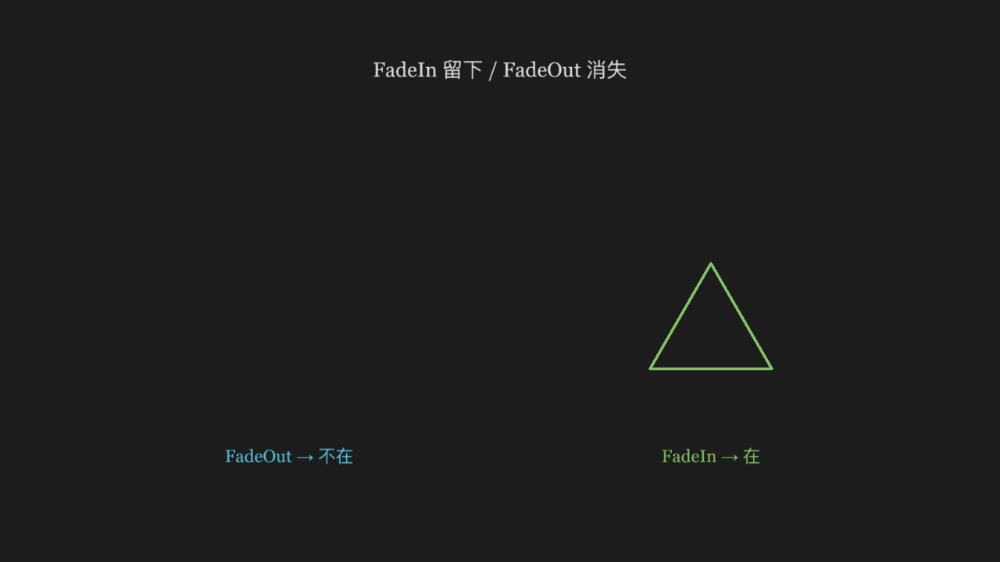

<<< @/../corpus/examples/animate/16-fade-family.py[代码]

:::

## GrowFromEdge / GrowFromCenter

GrowFromCenter 从中心冒出来，GrowFromEdge 沿指定边长出来，方向不同。

::: code-group

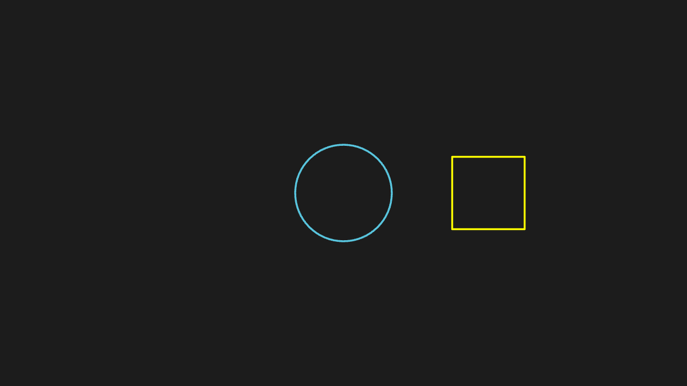

<<< @/../corpus/examples/animate/17-grow-family.py[代码]

:::
