<!-- 本文件由 scripts/gen-examples-docs.mjs 生成，不要手改：改语料或翻译表后重跑脚本。 -->

# 群论

循环群、Cayley 表、二面体群、生成元与子群、拉格朗日、置换复合、同态核、商群、子群格与轨道-稳定子。

本页 12 条示例。代码引自 `corpus/examples/math-group/`，截图为真机渲染的终态。

## 循环群 C4：正方形旋转 4 次回到原样

四个正方形排成一行，红点标记「被跟踪的那个角」：每次逆时针转 90°，红点依次走到四个角；R90 连着做两次正好落在 R180 上，R270 再转一次回到 R0。

::: code-group

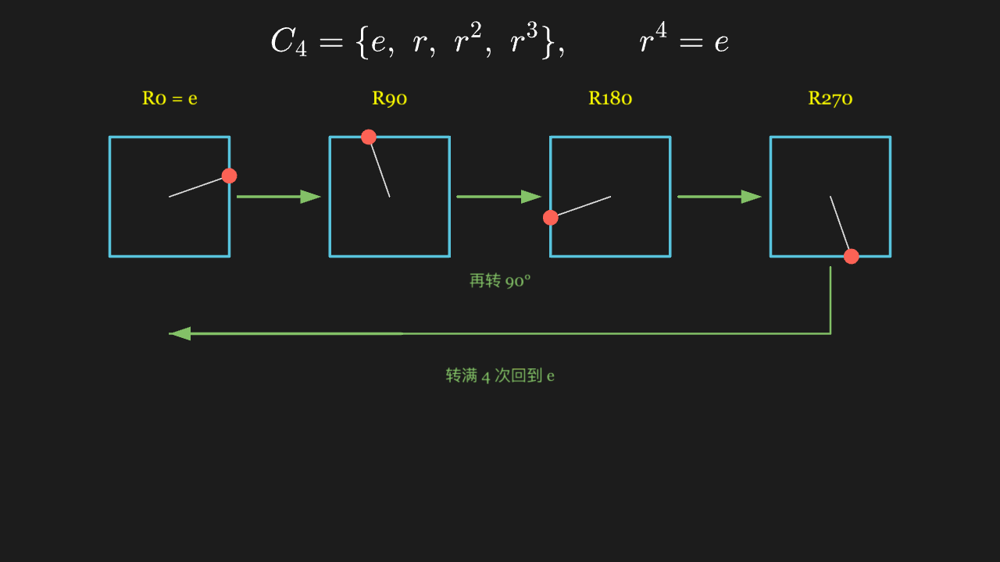

<<< @/../corpus/examples/math-group/01-cyclic-rotation-group.py[代码]

:::

## Cayley 表：一张表就把群的三条公理读出来

4×4 的加法表填满 (Z/4, +)：第一行（单位元 e=0 那一行）与表头完全一致，主对角线附近成对出现的 1↔3、2↔2 互为逆元——表里没有空格，说明运算封闭。

::: code-group

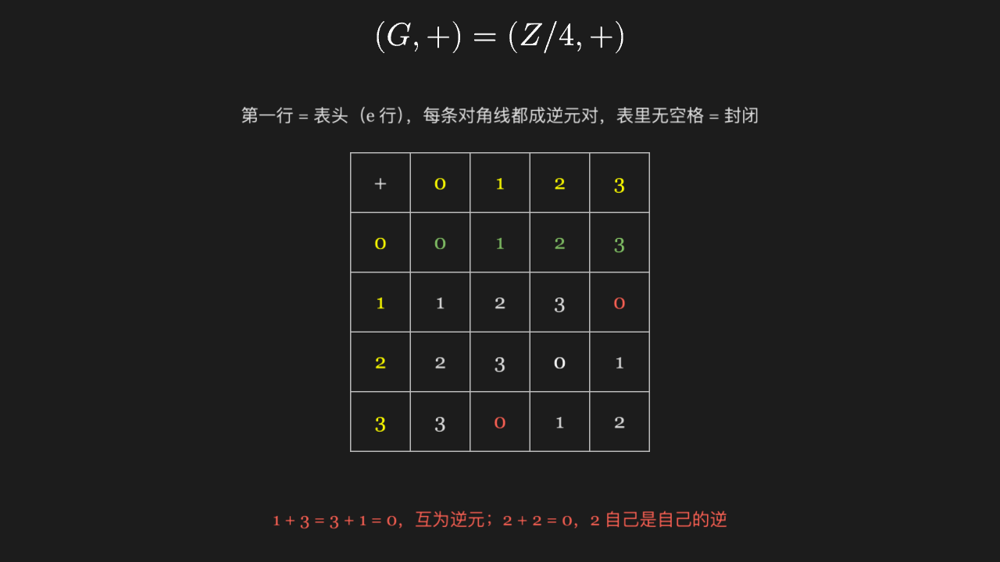

<<< @/../corpus/examples/math-group/02-cayley-table.py[代码]

:::

## 二面体群 D4：正方形的 8 个对称（4 旋转 + 4 镜像）

上排 4 个正方形分别是转 0° / 90° / 180° / 270°，下排 4 个是沿竖轴、横轴、两条对角线的镜像；标记点 8 次落在 8 个互不相同的位置，说明这 8 个变换两两不等。

::: code-group

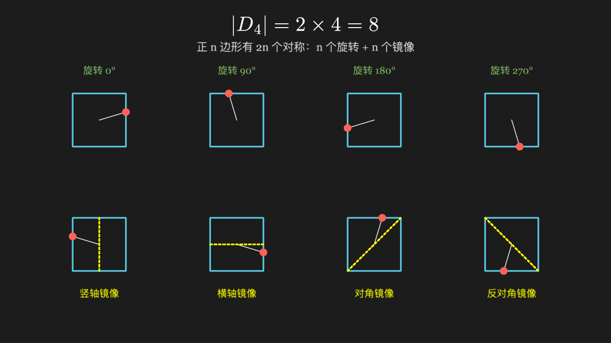

<<< @/../corpus/examples/math-group/03-dihedral-symmetry.py[代码]

:::

## 乘法群 (Z/7)*：谁是生成元，一眼看出阶

左右两个圆圈上同样摆着 1~6 六个元素。左边按「乘 2 取模 7」连箭头，走出两个互不相通的小环；右边按「乘 3 取模 7」连箭头，一根线串起全部六个元素最后回到起点。

::: code-group

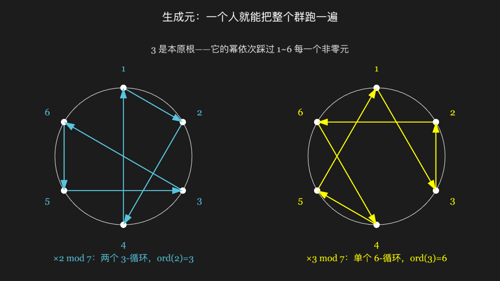

<<< @/../corpus/examples/math-group/04-modular-multiplication.py[代码]

:::

## 由生成元「带出来」的子群，阶永远整除全群

最上一行 12 个点代表 (Z/12, +) 的全部元素；下面四行分别把 ⟨1⟩ ⟨2⟩ ⟨3⟩ ⟨4⟩ 能到达的点点亮——依次点亮 12、6、4、3 个点，其余保持暗淡。

::: code-group

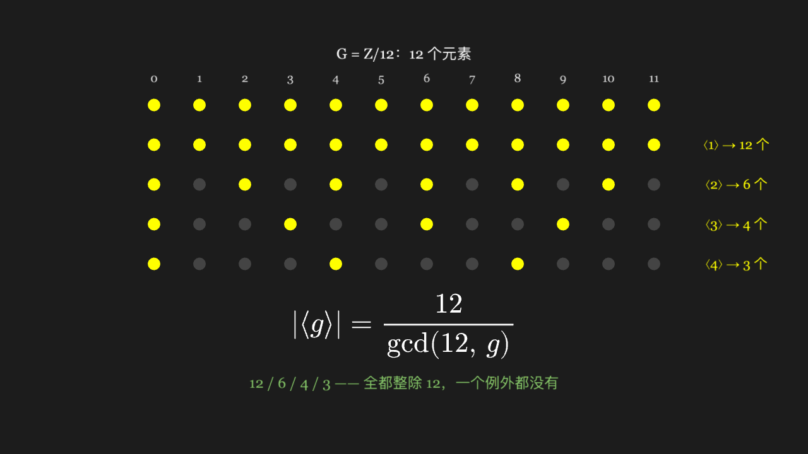

<<< @/../corpus/examples/math-group/05-generator-subgroups.py[代码]

:::

## 拉格朗日定理：子群把群等分成若干块，块数 × 块大小 = 群大小

12 个元素排成一行，按所属陪集染成绿 / 黄 / 蓝三种颜色——同色恰好 4 个、三种颜色共 12 个且互不重叠；配色在行内是交错的（0 绿 1 黄 2 蓝 3 绿…），说明陪集互相穿插却从不共用元素。

::: code-group

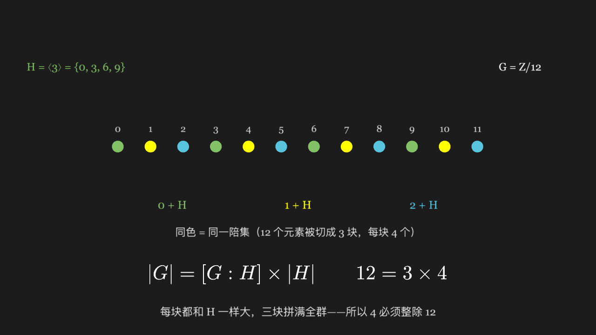

<<< @/../corpus/examples/math-group/06-lagrange-theorem.py[代码]

:::

## 置换的复合：先做谁、后做谁，结果不一样

四行三格的球位，上两行把「先 σ 后 τ」一步步做出来，最下一行换成「先 τ 后 σ」；两行终态的颜色排列明显不同——同一个集合、同一个运算，交换顺序就换了答案。

::: code-group

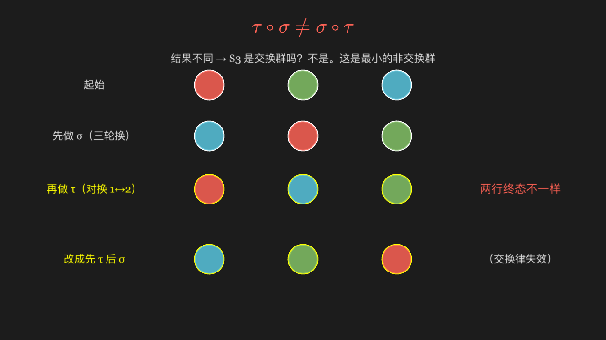

<<< @/../corpus/examples/math-group/07-permutation-composition.py[代码]

:::

## 同态：核有多大，像就有多小

左列 Z/6 的六个元素各引出一条箭头指向右列 Z/3 的像；0 和 3 两条红色箭头撞到同一个点 0 上——这两个元素构成核，正好是 2 个；右列三个点全被覆盖，像是 3 个。

::: code-group

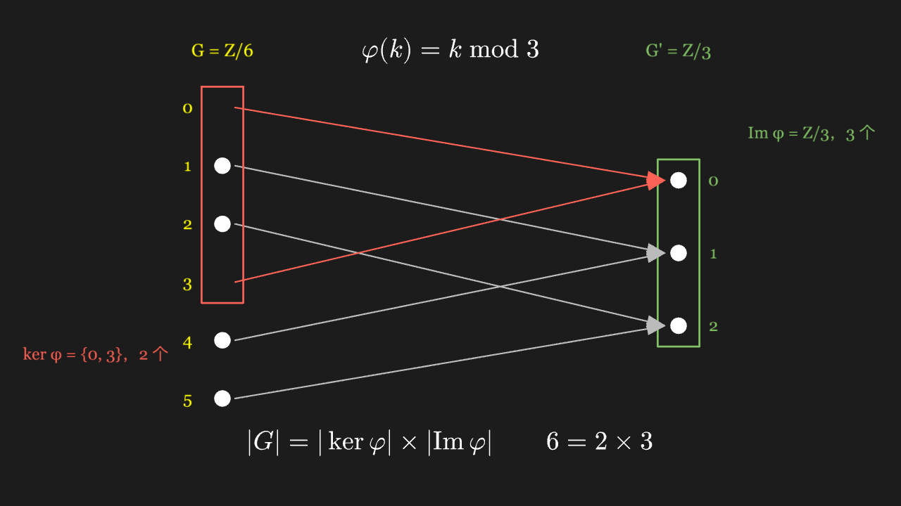

<<< @/../corpus/examples/math-group/08-homomorphism-kernel.py[代码]

:::

## 商群 G/N：把整个陪集「粘成」一个新元素

左边 Z/6 按列分成三组，每组就是一个陪集；三组各自收缩成下面一个粗点，得到只有 3 个元素的 G/N。右边新的加法表说明这 3 个新元素自己又构成一个群，结构正是 Z/3。

::: code-group

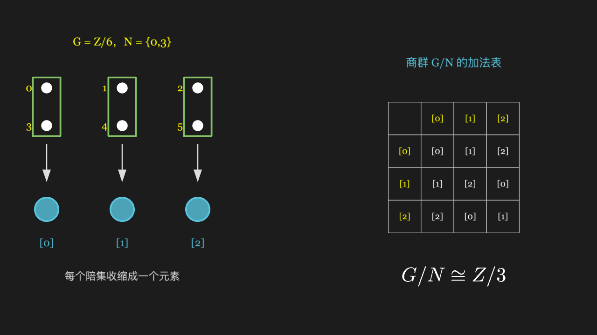

<<< @/../corpus/examples/math-group/09-quotient-group.py[代码]

:::

## 子群格：Z/12 的全部子群连成一张偏序图

六个节点按「包含关系」上下排列——最上是整个 Z/12，最下是 {0}，中间按阶数 6、4、3、2 依次铺开；连线只在「直接包含」的节点之间出现，构成一张格图。

::: code-group

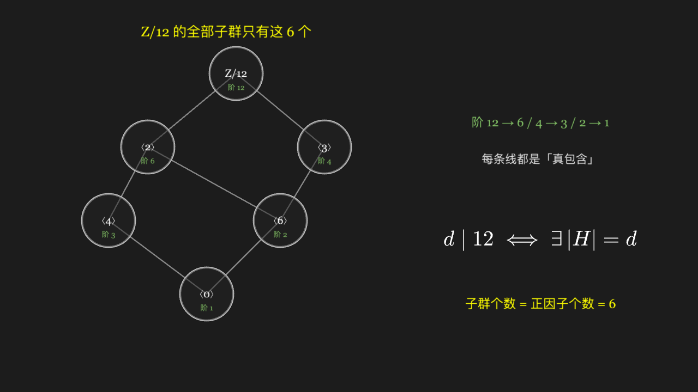

<<< @/../corpus/examples/math-group/10-subgroup-lattice.py[代码]

:::

## 对称群的阶按 n! 爆炸

六根柱子的高度只按 log10(n!) 等比缩放，所以画面上「看起来」只是平缓上升；但每根柱子顶端标的真实数值从 2 一路跳到 5040，涨幅完全不成比例。

::: code-group

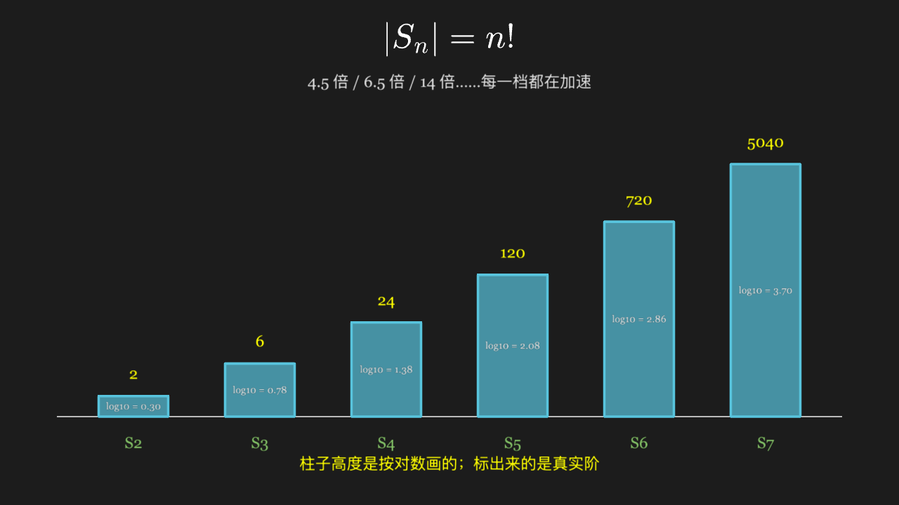

<<< @/../corpus/examples/math-group/11-symmetric-group-order.py[代码]

:::

## 轨道与稳定子：一个点被群推到哪些地方，谁又让它原地不动

左边正方形上，顶点 1 被群作用推到 2、3、4 三个位置（三条绿色箭头，顶点为黄色）——轨道有 4 个点；右下两个小正方形画的是让顶点 1 不动的两个对称（恒等、沿对角线镜像）。轨道数 × 稳定子数正好等于群的大小。

::: code-group

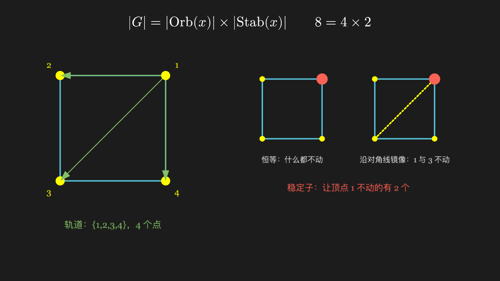

<<< @/../corpus/examples/math-group/12-orbit-stabilizer.py[代码]

:::
