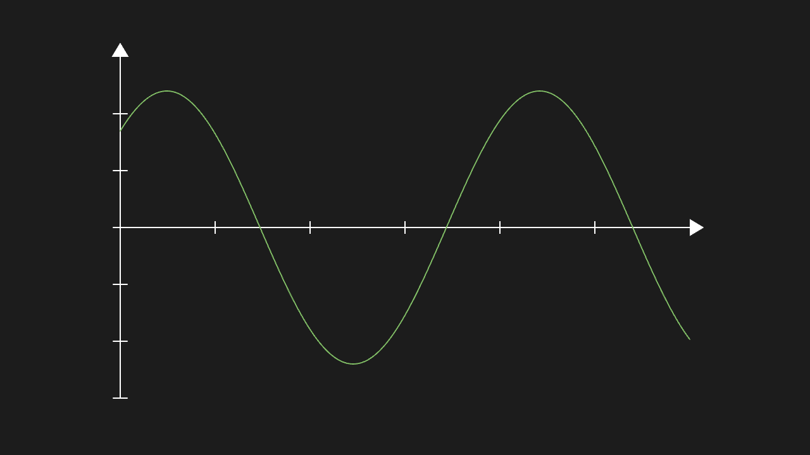
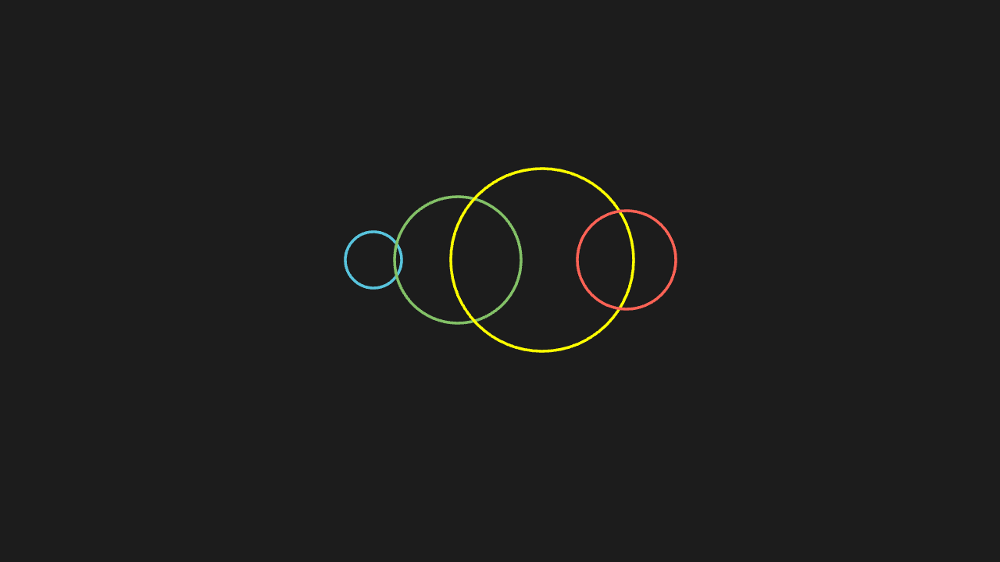

<!-- 本文件由 scripts/gen-examples-docs.mjs 生成，不要手改：改语料或翻译表后重跑脚本。 -->

# 语法综合（离线）

推导式、解包、闭包、生成器、dataclass、装饰器、异常与上下文管理器——只用 manim 加标准库，离线可跑。

本页 6 条示例。代码引自 `corpus/examples/syntax/`，截图为真机渲染的终态。

## 语法综合：推导式 / 解包 / 生成器表达式一起建图

推导式 / 解包 / 生成器表达式建出的图形数量与排布和源码逻辑一致（print 断言为准）。

::: code-group

<<< @/../corpus/examples/syntax/01-comprehensions.py[代码]

:::

## 语法综合：闭包 / 生成器函数 / itertools 链

闭包 / 生成器函数 / itertools 链建出的图形正常，数量与 itertools 的产物一致。

::: code-group

<<< @/../corpus/examples/syntax/02-closures-itertools.py[代码]

:::

## 语法综合：dataclass / 装饰器 / 类属性一起建图

dataclass / 装饰器 / 类属性跑通，建出的图形与数据一致。

::: code-group

<<< @/../corpus/examples/syntax/03-dataclass-decorator.py[代码]

:::

## 语法综合：异常处理 / 上下文管理器 / 自定义异常

异常被接住、上下文管理器正常进出（print 断言为准），画面正常。

::: code-group

<<< @/../corpus/examples/syntax/04-try-context.py[代码]

:::

## 语法综合：解包 / 格式化 / 切片与排序

解包 / 格式化 / 切片排序的结果正确（print 断言为准）。

::: code-group

<<< @/../corpus/examples/syntax/05-unpack-format.py[代码]

:::

## 语法综合：遍历 VGroup（for / 推导式 / 越界下标）

for 遍历 VGroup 正常收尾（不无限取下去），越界下标抛 IndexError。

::: code-group

<<< @/../corpus/examples/syntax/06-group-iteration.py[代码]

:::
