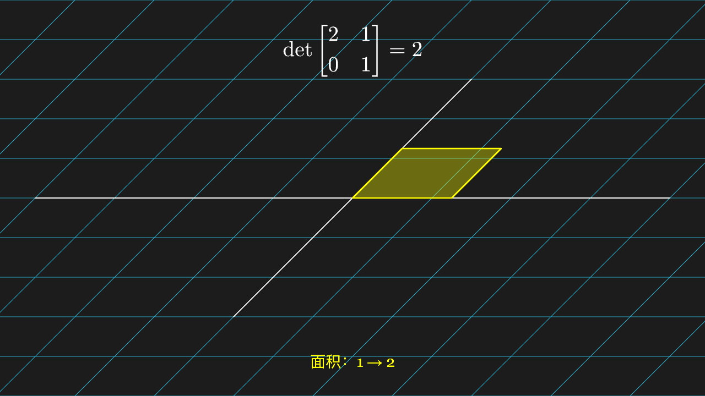
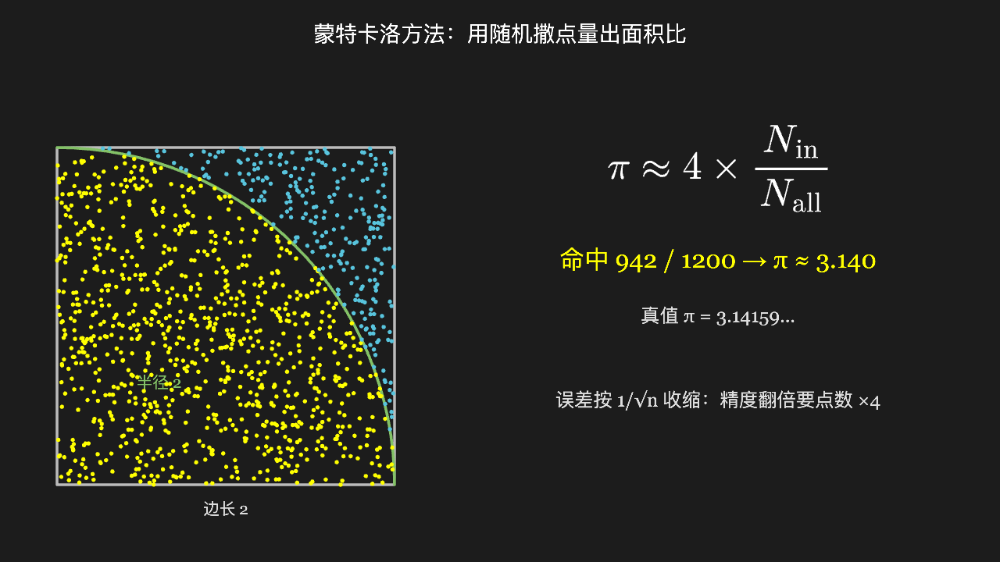

## 它渲出来的东西长这样

下面每一张都是**真机渲染的终态**：由 `scripts/shot-corpus.mjs` 用真 Chromium 逐条跑语料落图，
不是设计稿。源码与这张图的对应关系见[示例画廊](/examples/)。

  <figure>
    
    <figcaption>线性变换：单位正方形面积被放大 |det| 倍</figcaption>
  </figure>
  <figure>
    
    <figcaption>往正方形里撒点，数出 π ≈ 3.140</figcaption>
  </figure>
  <figure>
    
    <figcaption>ThreeDScene：有光有深度的真 3D</figcaption>
  </figure>

::: warning 截图是终态，动画不是
截图抓的是一段动画播完后的那一帧。**动画过程本身**（物体怎么动、怎么变形）静态图呈现不了——
本仓自带一个本地演示台，`pnpm playground` 起来后 239 条语料都能点开实播。它只留在本地开发用，
不随文档上线。
:::

## 全部章节

文档站的左侧栏是整站目录（VitePress 的首页按惯例不带侧栏，所以这一页把目录也列一份在下面）。

| 章节 | 讲什么 |
| --- | --- |
| [安装](/guide/installation) | 装包、两样外部资源（Pyodide / KaTeX）、浏览器要求 |
| [快速开始](/guide/quick-start) | 二十行跑出第一幅画面，逐步说清每一步不调会怎样 |
| [在各框架里用](/guide/frameworks) | 原生 JS / React / Vue，以及画布生命周期的两个实务 |
| [必须知道的三条契约](/guide/contracts) | 多实例单例、`dispose()` 真释放、单段独立执行；外加「复用画布的坑」 |
| [第三方包从哪来、缓存在哪](/guide/packages) | `import pandas` 取不到包时到底发生了什么，三种环境各自的取法与缓存 |
| [在 Node 里干跑预检](/guide/node) | 不碰 DOM 的 CI 预检 |
| [渲染成品画廊](/examples/) | 10 张真机渲染的成品 + 对应语料源码 |
| [公开接口](/api/) | `createManimRenderer` / `Surface` / 导出接入者 / 低层入口 |
